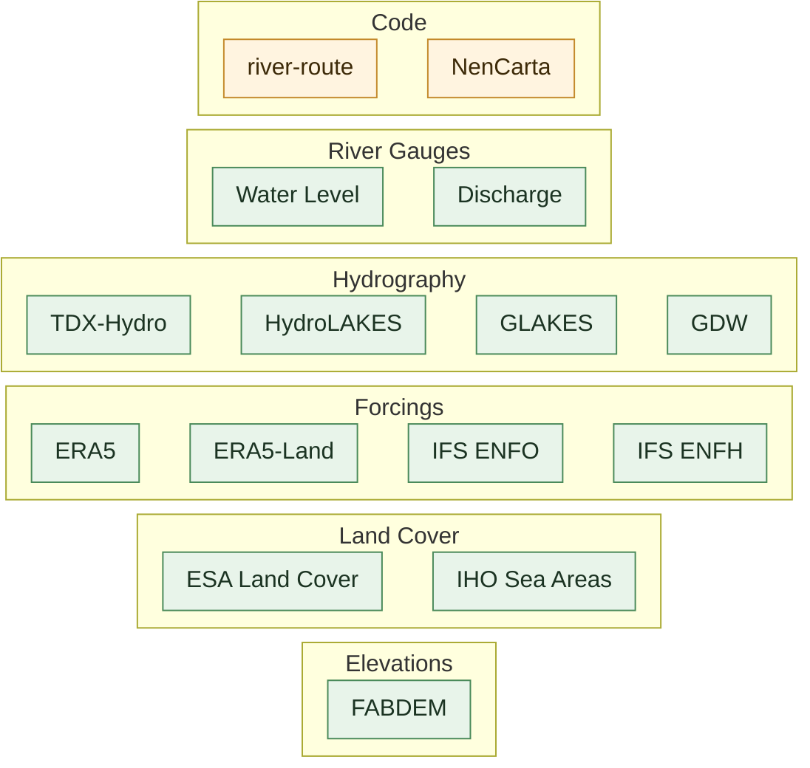
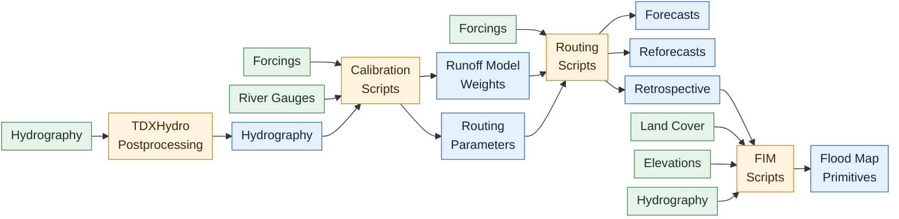
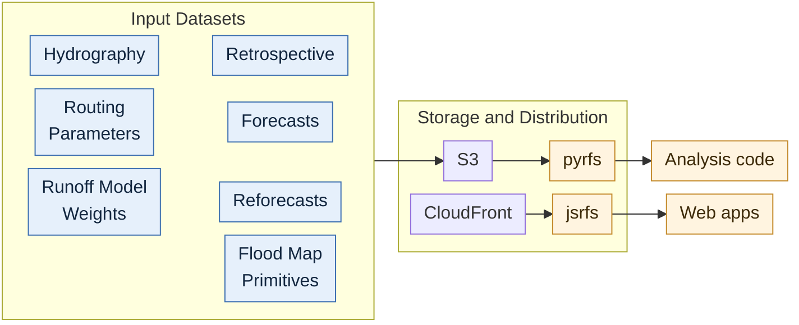

# RFS V3

<mark>DRAFT DOCUMENT. THE DATA IN THIS DOCUMENT IS NOT VERIFIED. THE DATA CAN CHANGE.</mark>

This is the design document for version 3.0 of the River Forecast System (RFS). The release date of RFS v3 is 1 March 2027.

**RFS v3 makes 5 primary datasets**

1. [Hydrography](#hydrography) and [Model Configs](#routing-configurations). These do not change during a release.
2. [Retrospective simulation and the products made from it](#retrospective-simulation-products)
3. [15 Day Reforecasts](#reforecast-products)
4. [15 Day Forecasts and the products made from them](#flood-forecast-products)
5. [Flood map primitives](#flood-map-primitives). These are the parts that RFS uses to make flood maps.

**Data Distribution Tools**

1. [AWS S3 bucket](#organization-on-s3), `s3://river-forecast-system-v3/`
2. CloudFront Distribution, <https://v3.s3.riverforecastsystem.com>
3. Code packagesact same directory structure as the bucket.
    1. Python: [river-forecast-system/py-rfs-client](https://github.com/river-forecast-system/py-rfs-client)
    2. JavaScript: [river-forecast-system/js-rfs-client](https://github.com/river-forecast-system/js-rfs-client)
4. Web apps:
    1. Hydroviewer (shows data and maps) <https://apps.geoglows.org/rfs>
    2. Data Store (find and download the products) <https://apps.geoglows.org/rfs-datastore>
5. Web map layers:
    1. [ArcGIS Living Atlas web map layer](#web-maps)
    2. PMTiles for the streams, catchments, and regions

| Discharge Product     | Updated | Native Time Step | Forcings       | Forcing Spatial resolution | Time Covered     | Lead/Lag time |
|-----------------------|---------|------------------|----------------|----------------------------|------------------|---------------|
| Retrospective         | Daily   | 1 Hourly         | ERA5, ERA5Land | 0.25 degree grid           | Since Jan 1940   | 5 Days Lag    |
| Reforecasts           | Once    | 6 Hourly         | IFS ENFH 49r1  | O1280 (~9km equator)       | 2005-2024        | 15 Day Lead   |
| Operational Forecasts | Daily   | 3 Hourly         | IFS ENFO 50r1  | O1280 (~9km equator)       | Since March 2027 | 15 Day Lead   |

## Journal Papers

- <mark>TBD</mark>

## Model Conceptual Diagrams

The diagrams in this section show RFS v3 in three parts:

1. **Dependencies.** These are the datasets and code that RFS v3 uses. They do not change frequently. Their development is separate from the model.
2. **RFS calculations.** These change the dependencies into products.
3. **Data storage and distribution.** This is how RFS keeps the products and how users get them.

The colors in the diagrams have these meanings:

- Green is a dataset.
- Orange is code.
- Blue is a product.

### Dependencies



| Group        | Dependency     | Link                                                                                                | Used in                              |
|--------------|----------------|-----------------------------------------------------------------------------------------------------|--------------------------------------|
| Code         | river-route    | [rileyhales/river-route](https://github.com/rileyhales/river-route)                                 | Calibration Scripts, Routing Scripts |
| Code         | NenCarta       | [jlgutenson/nencarta](https://github.com/jlgutenson/nencarta)                                       | FIM Scripts                          |
| River Gauges | Water Level    | [river-forecast-system/river-gauge-data](https://github.com/river-forecast-system/river-gauge-data) | <mark>TBD</mark>                     |
| River Gauges | Discharge      | [river-forecast-system/river-gauge-data](https://github.com/river-forecast-system/river-gauge-data) | Calibration Scripts                  |
| Forcings     | ERA5           | [ERA5 hourly, single levels](https://doi.org/10.24381/cds.adbb2d47)                                 | Calibration Scripts, Retrospective   |
| Forcings     | ERA5-Land      | [ERA5-Land hourly](https://doi.org/10.24381/cds.e2161bac)                                           | Calibration Scripts, Retrospective   |
| Forcings     | IFS ENFO       | [ENS 15-day forecast](https://www.ecmwf.int/en/forecasts/datasets/set-iii)                          | Forecasts                            |
| Forcings     | IFS ENFH       | [ENS 15-day forecast](https://www.ecmwf.int/en/forecasts/datasets/set-iii)                          | Reforecasts                          |
| Hydrography  | TDX-Hydro      | [TDX-Hydro](https://doi.org/10.22541/essoar.171629686.65893579/v1)                                  | TDXHydro Postprocessing              |
| Hydrography  | HydroLAKES     | [HydroLAKES](https://www.hydrosheds.org/products/hydrolakes)                                        | TDXHydro Postprocessing              |
| Hydrography  | GLAKES         | [GLAKES](https://doi.org/10.5281/zenodo.7016548)                                                    | TDXHydro Postprocessing              |
| Hydrography  | GDW            | [Global Dam Watch v1.0](https://doi.org/10.6084/m9.figshare.25988293.v1)                            | TDXHydro Postprocessing              |
| Elevations   | FABDEM         | [FABDEM V1-2](https://doi.org/10.5523/bris.s5hqmjcdj8yo2ibzi9b4ew3sn)                               | FIM Scripts                          |
| Land Cover   | ESA Land Cover | [ESA WorldCover](https://esa-worldcover.org/en)                                                     | FIM Scripts                          |
| Land Cover   | IHO Sea Areas  | [IHO Sea Areas v3](https://doi.org/10.14284/323)                                                    | FIM Scripts                          |

### RFS Calculations

!!! info "Datasets"
**For the full list of datasets and more data about each dataset, refer to [Available Products](#available-products).**



| Component               | Repository                                                                                                      | Responsible                        |
|-------------------------|-----------------------------------------------------------------------------------------------------------------|------------------------------------|
| TDXHydro Postprocessing | [geoglows/tdxhydro-postprocessing](https://github.com/geoglows/tdxhydro-postprocessing)                         | Riley Hales, Rachel Huber Magoffin |
| Calibration Scripts     | [river-forecast-system/v3-calibration-scripts](https://github.com/river-forecast-system/v3-calibration-scripts) | Riley Hales                        |
| Routing Scripts         | [river-forecast-system/v3-routing-scripts](https://github.com/river-forecast-system/v3-routing-scripts)         | Riley Hales, Michael Souffront     |
| FIM Scripts             | [river-forecast-system/v3-fim-scripts](https://github.com/river-forecast-system/v3-fim-scripts)                 | Ricky Rosas, Riley Hales           |

### Data Storage and Distribution

!!! info "Datasets"
**For the full list of datasets and more data about each dataset, refer to [Available Products](#available-products).**



| Component       | Repository                                                                                                      | Responsible                    |
|-----------------|-----------------------------------------------------------------------------------------------------------------|--------------------------------|
| pyrfs           | <mark>TBD</mark>                                                                                                | Riley Hales                    |
| jsrfs           | [river-forecast-system/js-riverforecastsystem](https://github.com/river-forecast-system/js-riverforecastsystem) | Riley Hales, Michael Souffront |
| RFS Hydroviewer | [geoglows/webapp-rfs-v3](https://github.com/geoglows/webapp-rfs-v3)                                             | Riley Hales                    |
| RFS Data Store  | [geoglows/data-store-app](https://github.com/geoglows/data-store-app)                                           | Riley Hales, Michael Souffront |

### Products not yet in this specification

Each product in the diagrams must have a short name in [Products](#products). Each product must also have a section in
[Available Products](#available-products). The products that follow do not have them yet:

1. **Observations.** This is the river gauge database that the Calibration Scripts read. It is an input, not a published product. To make the
   calibrated products again, you must know which version of the database the calibration used.
2. **Routing Parameters.** RFS publishes them as `network.parquet` in [Routing Configurations](#routing-configurations). This document does not yet
   show how a release records the equation fit and the basin calibrations that made the parameters.
3. **Runoff Model Weights.** The Calibration Scripts write two files. `runoff_correction.pt` is the trained correction. `river_losses.parquet` is the
   list of losing rivers, and their losses, that the training used. Production routing must apply these losses, but river-route cannot apply them yet.
   The two files do not have a short name or a location in the bucket.
4. **Corrected forcings.** In the RFS Calculations diagram, the Routing Scripts apply the runoff weights. This document does not yet tell if RFS
   publishes the corrected runoff or only calculates it before the routing.

These products are in this document, but they do not have a short name:

- The forcings. They are in the bucket under `forcings/`.
- The forecast alerts, map stylesets, and warm states. They are files in the `forecast-15day` partition.

## Migration from v2 to v3

This section is the migration guide for users who change from v2 to v3. It is the only section that compares v3 to v2. All other sections are about v3
only. If you did not use v2, go to [Available Products](#available-products).

### Renames

These name changes cause most of the work to change v2 code for v3.

| v2                                                         | v3                    | Notes                                                                           |
|------------------------------------------------------------|-----------------------|---------------------------------------------------------------------------------|
| `rivid` (forecasts from RAPID), `river_id` (retrospective) | `riverId`             | v3 uses one name in all products. v2 used a different spelling in each product. |
| `Qout`                                                     | `Q`                   | v3 uses one name in all products and in the ensemble arrays.                    |
| `return_period`                                            | `recurrence_interval` | The type is now `float32`, not int, because the axis has a 1.5 year value.      |

### Discharge values

- **`riverId` is now the first dimension, not `time`.** All discharge arrays are `(riverId, time)`. In v2, they were `(time, riverId)`. An indexed
  read is now `Q[river, time]`. Code that uses xarray dimension names does not change. Code that uses the position of a dimension must change. Refer
  to [Chunking and sharding](#chunking-and-sharding).
- **Discharge is bitrounded `float32`.** The precision is now relative, not absolute. Refer to [Encoding and compression](#encoding-and-compression).
- **The `riverId` order is now a formal promise.** The axis has a topological sort, and it is the same in all products. The axis is not in ascending
  id order. You cannot use a binary search on the published array to find an id. The new `riverIndex` attribute on the streams gives the position of a
  river. With `riverIndex`, you do not have to look up the river before you download its data.
- **Flow duration curves are `float32` and bitrounded**, the same as all other discharge arrays. v2 stored them as `float64`.
- The streams have more attributes, and some attributes have new names. These changes make the data easier to understand and use.
- The hydrography geometry is now EPSG:3857, not EPSG:4326. Refer to [Geometry storage](#geometry-storage).

### New in v3

- RFS publishes the confluences, catchments, and region outlines for each region. It also publishes a global attribute table (`metadata.parquet`,
  `metadata.zarr`).
- RFS publishes the edits that the pipeline made to TDX-Hydro in `region=<id>/mods/`, next to the network. With these edits, you can find the v3 reach
  that now contains each source reach.
- All reaches have a `riverIndex` and an `upstreamCount`. A river and all reaches upstream of it are one contiguous row range,
  `[riverIndex - upstreamCount, riverIndex]`. This is true in all tables and all Zarr stores.
- Lake and reservoir routing. The network itself contains the lakes and reservoirs. The pipeline removes the interior reaches, and the inlets point to
  the outlet. The outlet reach has a traced line through the lake. There is no separate lakes layer. Refer to
  [Lakes and reservoirs](#lakes-and-reservoirs).
- The return periods have a 1.5 year recurrence interval. They also have an `annual_exceedance_probability` array, calculated from the recurrence
  interval.
- Flood map primitives. These are the ARC tables and FLDPLN libraries that you use to map a flood scenario. They are in 1x1 degree tiles. RFS also
  publishes the forecast flood extents and the return period flood maps that it makes from them. Refer
  to [Flood Map Primitives](#flood-map-primitives).
- Reforecasts. RFS routes the IFS reforecasts of 2005 to 2024 with the same method as the forecasts. Use them to measure the forecast skill. Refer to
  [Reforecast Products](#reforecast-products).
- Routing calibration. The Calibration Scripts calibrate Muskingum k and x against observed discharge. Refer to [RFS Calculations](#rfs-calculations).
- Runoff calibration. A model corrects the land surface model runoff. The Calibration Scripts train this model against observed discharge. Refer to
  [RFS Calculations](#rfs-calculations).
- An official JavaScript package, [`jsrfs`](https://github.com/river-forecast-system/js-riverforecastsystem). Use it to read the published Zarr
  stores.
- A CloudFront distribution, <https://v3.s3.riverforecastsystem.com>. It gives access to the full bucket over HTTPS. Refer to
  [Data Organization](#data-organization).act same directory structure as the bucket.

### Discontinued in v3

- The forecast records product
- The "52nd ensemble member", IFS HRES. ECMWF stopped HRES because it became the same as the control forecast. The `member` axis is now 0..50, the
  ECMWF numbering. No member is outside the axis.
    - <https://www.ecmwf.int/en/about/media-centre/focus/2024/plans-high-resolution-forecast-hres-and-ensemble-forecast-ens>
- The https://geoglows.ecmwf.int web portal

### Model changes behind the numbers

These changes have an effect on the values themselves, not on how you read them. A difference between the v2 and v3 values at a river is not an error.

- The forecasts and the retrospective simulation use shared initializations. This connects them closely.
- The total stream count decreased from approximately 6.8 million to approximately 4.9 million. This reduces compute time and storage space needs. The
  pipeline primarily removed streams described in [Network simplification](#network-simplification). Some modifications were necessary because of the
  removals. ID numbers from v2 are generally valid in v3.
    - Streams in the middle of deserts, in lakes, in oceans, and on small islands
    - Streams in terminal watersheds smaller than 250 km2
    - Reaches shorter than 2 km
- RFS aggregates the runoff volumes to the catchments directly from the native mesh of the IFS version. This mesh is octahedral, or reduced gaussian.
  RFS does not resample the runoff to a uniform lat/lon grid.
- RFS v3 uses river-route (Python) for matrix Muskingum routing. v2 used RAPID (Fortran that the user compiles). river-route divides each reach into
  synthetic subreaches for better computational stability.
- RFS bitrounds the discharge to 13 keepbits. The data compresses much better, but the bitrounding changes the values after the calculation.

## Available Products

### Data Organization

- All v3 data is in one bucket, `s3://river-forecast-system-v3/`. You can also get the data through the CloudFront CDN at
  `https://v3.s3.riverforecastsystem.com`.
- In each product, the subdivisions use act same directory structure as the bucket.hive partition names.
    - The hydrography and routing configuration files are divided by HydroBASINS level 2 region numbers, for example `region=1020000010`. A product
      that cover all regions is in `hydrography/global/`.
    - The forecasts and reforecasts are divided by year, then month, then day: `forecast15/year=YYYY/month=MM/day=DD`.
    - The flood map primitives are divided into 1x1 degree tiles. The latitude and longitude identify each tile: `lat=YY/lon=XXX`. The latitude
      numbers span -90...90 and are zero padded to 2 digits. The longitude numbers span -180...180 and are zero padded to 3 digits.
- The runoff forcings that the router reads are in the bucket under `forcings/`.
    - ERA5 has one Zarr for each year, `era5/YYYY.zarr`.
    - IFS has one directory of GRIB files for each initialization, `ifs/YYYYMMDDHH/`.
- The monthly and yearly Zarr stores each have the averages in two chunk forms: one for timeseries and one for timesteps.

### Products

Some products have a short name. A short name is unique in this model version, and it does not change between releases. The data store page of a
product is at `/rfs-data-store/datasets/v3/<short name>`, so the short name is a permalink. Short names are lower case and use hyphens. A short name
tells what the product is, not where it is in the bucket. All times are UTC.

| Short name               | Product                    | Category             | Format          | Updated              | Size             |
|--------------------------|----------------------------|----------------------|-----------------|----------------------|------------------|
| `streams`                | Stream centerlines         | Hydrography          | GeoParquet      | Static               | ~15 GB           |
| `catchments`             | Catchment boundaries       | Hydrography          | GeoParquet      | Static               | <mark>TBD</mark> |
| `confluences`            | Confluence points          | Hydrography          | GeoParquet      | Static               | <mark>TBD</mark> |
| `metadata`               | Stream attributes          | Hydrography          | Parquet, Zarr   | Static               | <mark>TBD</mark> |
|                          | Stream tiles               | Hydrography          | PMTiles         | Static               | <mark>TBD</mark> |
|                          | Catchment tiles            | Hydrography          | PMTiles         | Static               | <mark>TBD</mark> |
|                          | Region tiles               | Hydrography          | PMTiles         | Not built            | <mark>TBD</mark> |
|                          | Modification records       | Hydrography          | JSON            | Static               | <mark>TBD</mark> |
| `routing-configs`        | River-route configs        | Model Configs        | Parquet, netCDF | Static               | <mark>TBD</mark> |
| `retrospective-hourly`   | Hourly discharge           | Retrospective        | Zarr            | Daily, by 01:00      | <mark>TBD</mark> |
| `retrospective-daily`    | Daily discharge            | Retrospective        | Zarr            | Daily, by 01:00      | <mark>TBD</mark> |
| `retrospective-monthly`  | Monthly discharge          | Retrospective        | Zarr            | Monthly, by the 6th  | <mark>TBD</mark> |
| `retrospective-yearly`   | Yearly discharge           | Retrospective        | Zarr            | Yearly, by 6 January | <mark>TBD</mark> |
| `annual-maximums-hourly` | Annual maximums (hourly)   | Retrospective        | Zarr            | Yearly, by 6 January | <mark>TBD</mark> |
| `annual-maximums-daily`  | Annual maximums (daily)    | Retrospective        | Zarr            | Yearly, by 6 January | <mark>TBD</mark> |
| `return-periods`         | Return periods             | Retrospective        | Zarr            | Static               | <mark>TBD</mark> |
| `flow-duration-curves`   | Flow duration curves       | Retrospective        | Zarr            | Static               | <mark>TBD</mark> |
| `forecast-15day`         | 15-day ensemble forecast   | Forecasts            | Zarr            | Daily, before 12:00  | <mark>TBD</mark> |
|                          | Map stylesets              | Forecasts            | bin + JSON      | Daily, with forecast | <mark>TBD</mark> |
|                          | Alerts                     | Forecasts            | CSV             | Daily, with forecast | <mark>TBD</mark> |
|                          | Esri animation tables      | Forecasts            | CSV             | Daily, with forecast | <mark>TBD</mark> |
|                          | Warm states                | Forecasts            | Parquet         | Daily, with forecast | <mark>TBD</mark> |
| `reforecast-15day`       | 15-day ensemble reforecast | Reforecasts          | Zarr            | Static               | <mark>TBD</mark> |
| `fldpln-libraries`       | FLDPLN libraries           | Flood map primitives | Parquet, Zarr   | Static               | <mark>TBD</mark> |

### Organization on S3

The bucket is `s3://river-forecast-system-v3/`. The primary method of accessing data should be directly from the bucket. Websites which much access
the data over https may use a CloudFront CDN at `https://v3.s3.riverforecastsystem.com`. The CDN follows the exact same directory structure as the
bucket.

```text
s3://river-forecast-system-v3/
├── hydrography/
│   ├── global/                                 # the products that span every region
│   │   ├── metadata.parquet                    # every reach's attributes, all regions concatenated in riverIndex order
│   │   ├── metadata.zarr/                      # the network walking columns as chunked arrays, for browser clients
│   │   ├── streams.pmtiles                     # z0-11, for mapbox-gl-js, maplibre, leaflet, etc
│   │   ├── catchments.pmtiles                  # catchment polygons and boundaries, for the same clients
│   │   ├── regions.pmtiles                     # z0-12, region outlines - NOT CURRENTLY BUILT
│   │   ├── tdxhydro_to_v3_id_map.parquet       # optional, every source TDX-Hydro reach to the v3 reach representing it
│   │   └── streams_map_optimized.gdb.zip       # for esri map layers - not produced by the hydrography pipeline, TBD
│   └── region=<id>/                            # all geometry epsg3857 snapped to a 1 m grid, geoarrow geoparquet 1.1
│       ├── streams_<id>.geo.parquet            # TDX-Hydro derived - the only streams product, full attribute table
│       ├── metadata_<id>.parquet               # the streams' attribute table without geometry, plus outlet lat/lon
│       ├── catchments_<id>.geo.parquet         # TDX-Hydro derived - one polygon per reach
│       ├── confluences_<id>.geo.parquet        # TDX-Hydro derived - junction points
│       ├── boundary_<id>.geo.parquet           # the region's outline
│       ├── mods/                               # the edits made to TDX-Hydro, the provenance of this network
│       │   ├── lake_edits.json
│       │   ├── zero_length_streams.json
│       │   ├── coastal_orphans.json
│       │   ├── headwater_dissolves.json
│       │   ├── branches_to_prune.json
│       │   └── short_consolidations.json
│       └── synthetic_rating_curve.parquet      # from ARC, for routing, FIM? Q_baseflow depends on a modeled value! - TBD
├── routing/                                    # routing configurations, made by the Calibration Scripts from hydrography/
│   ├── global/                                 # every region's files concatenated in riverIndex order, to route the world at once
│   │   ├── network.parquet
│   │   ├── gridweights_ERA5_global.nc
│   │   ├── gridweights_ERA5Land_global.nc
│   │   └── gridweights_O1280_global.nc
│   └── region=<id>/                            # the regions of hydrography/, rivers in the same riverIndex order
│       ├── network.parquet                     # the Routing Parameters: calibrated Muskingum k/x and connectivity, for river-route
│       ├── gridweights_ERA5_<id>.nc            # runoff grid to catchment weights, one per forcing grid, the standard format
│       ├── gridweights_ERA5Land_<id>.nc        # ERA5-Land, 0.1 degree
│       └── gridweights_O1280_<id>.nc           # IFS reduced gaussian grid weights, for the forecasts and reforecasts
├── forcings/                                   # the runoff the router reads, see Model Conceptual Diagrams
│   ├── era5/
│   │   └── YYYY.zarr/                          # Zarr v3, ro only, chunks 16 x 16 on lat/lon and the whole year on time
│   └── ifs/
│       └── YYYYMMDDHH/                         # one directory per forecast initialization
│           └── <filename>.grib                 # the IFS GRIB files for that initialization
├── retrospective/
│   ├── hourly.zarr/
│   ├── daily.zarr/
│   ├── monthly.zarr/                           # holds both Q and Q_timesteps
│   ├── yearly.zarr/                            # holds both Q and Q_timesteps
│   ├── return-periods.zarr/
│   ├── maximums.zarr/
│   └── fdc.zarr/
├── flood-map-primitives/
│   └── lat=YYY/
│       └── lon=XXX/
│           ├── return_period_maps/
│           │   ├── rp2.tif
│           │   ├── rp5.tif
│           │   ├── rp10.tif
│           │   ├── rp25.tif
│           │   ├── rp50.tif
│           │   └── rp100.tif
│           ├── arc/
│           │   ├── vdt.parquet
│           │   └── representative_xsections.parquet
│           └── fldpln/
│               ├── fldpln_library.parquet
│               ├── stream_info.parquet
│               └── fldpln.zarr/
│                   ├── library/
│                   ├── streams/
│                   └── zarr.json
├── forecasts15/                                # 15 day @ 3 hour forecasts, lead_time coordinate alongside absolute time
│   └── year=YYYY/
│       └── month=MM/
│           └── day=DD/
│               ├── alerts.csv                  # for CAP alerts
│               ├── maps/                       # summary files
│               │   ├── esri_animation_tables/  # for animated forecast layer (arcgis living atlas)
│               │   │   ├── YYYYMMDDHH.csv
│               │   │   └── x120...
│               │   ├── timeseries/
│               │   │   ├── styles.bin
│               │   │   └── styles.json
│               │   ├── max-flow/
│               │   │   ├── styles.bin
│               │   │   └── styles.json
│               │   ├── below-q95/
│               │   │   ├── styles.bin
│               │   │   └── styles.json
│               │   └── time-to-peak/
│               │       ├── styles.bin
│               │       └── styles.json
│               ├── next-init-files/            # routing warm states, the next run's initialization
│               │   └── group=XXX/
│               │       └── warmstate_YYYYMMDDHHMM_groupXXX.parquet
│               ├── discharge.zarr/             # 15 day discharge of the 50+1 ensemble, see Zarr structuring
│               └── fim.geo.parquet             # vector extent polygons, faster/smaller, single file
└── reforecasts15/                              # 15 day @ 6 hour reforecasts of the 2025 production days, by start date
    └── year=YYYY/
        └── month=MM/
            └── day=DD/
                └── discharge.zarr/             # 15 day discharge of the 10+1 ensemble, see Zarr structuring
```

### Hydrography

| Property            | Value                                                                                                 |
|---------------------|-------------------------------------------------------------------------------------------------------|
| Streams (reaches)   | ~4.92 million (4,917,183 in the current build)                                                        |
| Partition           | 47 TDX-Hydro regions (HydroBASINS level 2 ids, for example `1020000010`)                              |
| Terminal watersheds | 12,446                                                                                                |
| Reference product   | TDX-Hydro                                                                                             |
| Preparation code    | [`tdxhydro-postprocessing`](https://github.com/geoglows/tdxhydro-postprocessing), refer to its README |

The hydrography is divided by **HydroBASINS level 2 region**. Each region is a `region=<id>` hive partition in the bucket. The products that cover all
regions are in `hydrography/global/`.

For the list of files, refer to [Organization on S3](#organization-on-s3). RFS makes the routing configurations from this network, but it publishes
them separately. Refer to [Routing Configurations](#routing-configurations).

The [Technical Appendix](#hydrography-details) gives more data about the row order, attribute schema, geometry storage, lakes, network simplification,
modification records, and vector tiles.

### Routing Configurations

| Property         | Value                                                                                                                                                            |
|------------------|------------------------------------------------------------------------------------------------------------------------------------------------------------------|
| Short name       | `routing-configs`                                                                                                                                                |
| Partition        | The same `region=<id>` as the hydrography, plus `routing/global/`                                                                                                |
| Contents         | `network.parquet`, the Routing Parameters, and one set of grid weights for each forcing grid (ERA5, ERA5-Land, IFS `O1280`)                                      |
| Preparation code | [`v3-calibration-scripts`](https://github.com/river-forecast-system/v3-calibration-scripts). Refer to its README for the file schemas and the calibration method |

The files that river-route needs to route a region are in `routing/`, separate from the hydrography. They are the same files that RFS uses to make the
official routing outputs. The Calibration Scripts make these files from the published hydrography. The Calibration Scripts only read the hydrography.
They do not change it. A new forcing grid changes `routing/`, but it never changes `hydrography/`.

The Routing Scripts read only `routing/`. `routing/global/` contains the files of all regions, one after the other. With these files, you can route
the full world in one process.

For the list of files, refer to [Organization on S3](#organization-on-s3). Each file has the rivers of the region in the `riverIndex` order of the
hydrography. Refer to [Row order](#row-order-riverindex-and-upstreamcount).

### Flood Forecast Products

RFS publishes the daily 15-day forecast in `forecasts15/`, with the partitions `year=YYYY/month=MM/day=DD/`. Each partition contains these files.
Refer to [Organization on S3](#organization-on-s3).

- `discharge.zarr`, the forecast discharge
- The map stylesets. Refer to [Forecast map stylesets](#forecast-map-stylesets).
- `alerts.csv`. Refer to [Forecast alerts](#forecast-alerts).
- The Esri animation tables
- `fim.geo.parquet`, the vector flood extents
- The routing warm states for the next run

The forecast discharge store contains these arrays:

1. `Q` (riverId, member, time): the 3 hourly discharge for each of the 50+1 IFS forecast members. `member` 0 is the control forecast. `member` 1..50
   are the perturbed forecasts with the same number.
2. `Qpercentiles` (riverId, percentiles, time): the 3 hourly ensemble discharge at deciles from 0 (minimum), to 50 (median), to 100 (maximum).
3. `Qmean` (riverId, time): the 3 hourly ensemble mean discharge.

### Reforecast Products

The reforecasts are the ECMWF IFS reforecasts (ENFH), routed with the same method as the daily forecast. With the reforecasts, you can measure the
forecast skill over two decades, not only over the days since v3 started. RFS publishes them in `reforecasts15/`. The partitions are
`year=YYYY/month=MM/day=DD/`, by the **start date** of each reforecast. Each start date has one `discharge.zarr`. Refer to
[Zarr structuring](#reforecasts15yearyyyymonthmmdaydddischargezarr).

| Property         | Value                                                                                                     |
|------------------|-----------------------------------------------------------------------------------------------------------|
| Short name       | `reforecast-15day`                                                                                        |
| Members          | 10+1: `member` 0 is the control, 1..10 are the perturbed reforecasts                                      |
| Horizon and step | 15 days at 6 hours, 60 steps                                                                              |
| Start dates      | The ENFH production days of 2025: the 1st, 5th, 9th, ... 29th of each month.                              |
| Initial state    | The channel state of the [retrospective simulation](#retrospective-simulation-products) at the start date |
| Recomputed       | No                                                                                                        |

Each reforecast starts from the channel state of the retrospective at its start date. Because of this, a difference between a reforecast and the
retrospective at the same time is an error of the forecast itself. It is not a difference in initial conditions.

The reference IFS version of the reforecasts is 49r1. This is the version of the 2025 production days. The operational forecasts use the latest
version which is currently 50r1. The reforecasts and the forecasts use different IFS versions from the start.

The reforecasts publish only discharge. They do not publish ensemble percentiles, an ensemble mean, map stylesets, alerts, or flood maps.

#### Forecast skill as the model changes

RFS calculates the reforecasts one time only. To route all start dates again, RFS must use approximately 10 TB of storage and process all the data
again each time. The reforecasts are a fixed record of the system behavior with these items:

- The IFS version of the 2025 production days
- The hydrography, Routing Parameters, and Runoff Model Weights of the release that routed them

Each store records its IFS version in its `ifs_cycle` attribute.

The operational forecasts continue to change after that:

- **IFS upgrades.** ECMWF replaces the operational IFS version approximately one time each year. After an upgrade, RFS forces all forecasts with the
  runoff of the new version. The biases of the new version are different from the biases of the version that the reforecasts used.
- **Corrections in other components.** Errors can occur in the hydrography, the Routing Parameters, the Runoff Model Weights, or the routing code.
  When RFS corrects an error, all forecasts after that use the correction. The reforecasts keep the behavior from before the correction.

**Use the reforecasts to measure the forecast skill. But know that the operational forecasts can become different from that skill over time.** The
reforecasts are the only record that is sufficiently long to measure the skill and bias at a river accurately. They continue to be the best estimate
of the forecast behavior. After an IFS upgrade or a correction, the skill and bias of a forecast can be different from the reforecasts. The forecast
can be better or worse. The difference can be larger at some rivers than at others.

### Retrospective Simulation Products

For the list of retrospective stores, refer to [Products](#products). For their structure, refer to [Zarr structuring](#zarr-structuring).

The routing warm states are not in `retrospective/`. RFS writes them for each computational unit, with the forecast that uses them. They are at
`forecasts15/year=YYYY/month=MM/day=DD/next-init-files/group=XXX/warmstate_YYYYMMDDHHMM_groupXXX.parquet`.

### Flood Map Primitives

Flood map primitives are not flood maps. They are the parts that you use to map a flood scenario. For a given discharge on each river, the ARC tables
and the FLDPLN library give the extent and depth of the flood. The forecast flood extents and the return period flood maps are two scenarios that RFS
maps with the primitives.

The primitives are in tiles, with the partitions `flood-map-primitives/lat=YYY/lon=XXX/`. Each tile contains the ARC tables and the FLDPLN library
that the flood worker uses. Each tile also contains the return period flood maps that RFS makes from them.

| File                                          | Format  | Description                                                         |
|-----------------------------------------------|---------|---------------------------------------------------------------------|
| `return_period_maps/rp{2,5,10,25,50,100}.tif` | GeoTIFF | Flood map for each return period, 2 to 100 years                    |
| `arc/vdt.parquet`                             | Parquet | ARC velocity, depth, and top width table                            |
| `arc/representative_xsections.parquet`        | Parquet | ARC representative cross sections                                   |
| `fldpln/fldpln_library.parquet`               | Parquet | FLDPLN library                                                      |
| `fldpln/stream_info.parquet`                  | Parquet | FLDPLN stream information                                           |
| `fldpln/fldpln.zarr/`                         | Zarr v3 | The FLDPLN library of the tile. The flood worker reads it directly. |

The daily forecast also publishes vector flood extents in one `fim.geo.parquet` file for each forecast. For map clients, this file is faster and
smaller than a set of rasters. Refer to [Flood Forecast Products](#flood-forecast-products).

For the internal layout of `fldpln.zarr`, refer to the [Technical Appendix](#flood-map-primitiveslatyyylonxxxfldplnzarr).

### Web Maps

1. Daily forecast flood
   maps [https://www.arcgis.com/home/item.html?id=8f0573e0c0b9491dbeafde9c72ccf02b](https://www.arcgis.com/home/item.html?id=8f0573e0c0b9491dbeafde9c72ccf02b)
2. Esri flood map layers (return period, forecast, or the two together)
    1. Return period flood maps
    2. Daily forecast flood maps, from the 90th percentile of the ensemble maximum

## Design Notes

This section gives the reasons for some of the design decisions above. Read it before you change these decisions.

- **Row order.** Of all post-orders, the post-order that goes into the largest subtree first gives the minimum distance between a reach and its
  downstream reach. Over all 3.89 million edges, the mean distance is 3.5 rows. Without this order, the mean is 135.3 rows. The 99th percentile is 28
  rows, against 1,451 rows without this order. The compressor and the routing kernel both use this locality.
- **Geometry storage.** Three steps together make the hydrography 60-70% smaller. No step is effective alone. First, a snap to a 1 m grid gives
  approximately 30 trailing zero mantissa bits in each float64 coordinate. A decimal degree grid cannot do this, because no decimal degree grid is a
  power of two. Second, geoarrow keeps x and y in separate columns. Third, `BYTE_STREAM_SPLIT` puts the zero bytes together, so zstd can compress them
  to almost nothing.
- **Compression level.** zstd level 3 uses the locality that the row order makes. On one region of 352,529 reaches, the result is 380 MB. With no row
  order and snappy compression, the result is 1,247 MB.
- **Chunking of long series.** In a test on a real group, one river in each chunk gave a compression ratio of 2.85x. The read time for one river was
  1.5 ms. With ten rivers in each chunk, the ratio was 2.16x and the read time was 2.8 ms. Wider C-order chunks interleave the rivers. This breaks the
  autocorrelation of each series.
- **Chunking of short series.** A short series of one river is 28 to 480 bytes. This is approximately the same as the 32 bytes of blosc header and
  index entry for each chunk. Because of this, short arrays have 250 or 1,000 rivers in each chunk. One-river chunks of yearly `Q` give a shard index
  of 800 KB, not 3 KB.
- **`riverId` first.** With one river in each chunk, `(1, n_time)` and `(n_time, 1)` chunks are the same on disk, byte for byte. The only advantage of
  river first is that writers do not have to transpose the data.
- **One keepbits.** At a fixed keepbits, rounding is idempotent. Because of this, all stores that RFS makes from the hourly values agree exactly with
  the hourly values. If you resample the hourly store, you get the same daily mean.

## Implementation Details

### Log/Status Feeds

RFS writes log messages to disk. It also sends status data to these locations:

- Teams channel webhook
- AWS CloudWatch logs

## Technical Appendix

This appendix gives more data about the products in the sections above.

### Hydrography details

#### Row order, `riverIndex`, and `upstreamCount`

All hydrography tables use one global row order. This order is also the `riverId` axis of all Zarr stores. `riverIndex` is the row position of a reach
in this order. `upstreamCount` is the number of reaches upstream of the reach. This count does not include the reach itself.

**The order is topological first.** Each reach is after all reaches that drain into it. The rules that follow are tie-breaks. RFS uses them only where
the topology does not set the order. The global order puts the regions in **ascending level 2 region number**. There is no other key at a higher
level, and there is nothing to look up. In each region, the order has two levels:

1. **Terminal watersheds, along a Hilbert curve through their outlet points** (16 bit index on the outlet lon/lat). Watersheds are disjoint
   components, so the topology does not set their order. The Hilbert curve puts adjacent basins next to each other in the file. This keeps the
   geometry compressible and the tiles coherent.
2. **Reaches in a watershed, in depth first post-order from the outlet, into the largest subtree first.** Post-order puts a reach after all reaches
   upstream of it, so the order is a valid topological sort. Each subtree is one contiguous interval that ends at its root.

This order gives three promises. The build asserts each promise. It does not assume them.

- **Upstream before downstream.** Each reach is after all reaches that drain into it.
- **Each river and its upstream reaches are one contiguous row range**, exactly `[riverIndex - upstreamCount, riverIndex]`. To find a river and its
  upstream reaches, use a range filter on a table or a Zarr store.
- **Each region is one contiguous row range.** The rows of a region are a slice of the global tables. A routing engine can use a region file as a
  dense array with the local index `riverIndex - riverIndexStart`. This is also true for each terminal watershed.

Because the order is topological and not ascending by id, a binary search on the published `riverId` array cannot find an id. To find a river, read
its `riverIndex` from the streams or the metadata.

#### Attribute schema

`metadata_<id>.parquet` and `streams_<id>.geo.parquet` have the same rows in the same order. The streams have a `geometry` column, but they do not
have `lat` and `lon`. `global/metadata.parquet` contains the metadata of all regions, one after the other, with the same columns. The network walking
columns are first. With this column order, a projected read of these columns is one contiguous run of column chunks.

| Column           | Type     | Description                                                                                                        |
|------------------|----------|--------------------------------------------------------------------------------------------------------------------|
| `riverId`        | int32    | Unique reach id. The TDX-Hydro `LINKNO` plus an offset for each region.                                            |
| `nextRiverId`    | int32    | Downstream reach id, -1 at an outlet                                                                               |
| `outletRiverId`  | int32    | The terminal outlet reach of the watershed of this reach                                                           |
| `riverIndex`     | int32    | Row position in the global order. Refer to the text above.                                                         |
| `upstreamCount`  | int32    | Number of reaches upstream, not including this reach. Range of indices: `[riverIndex - upstreamCount, riverIndex]` |
| `strahlerOrder`  | int32    | Strahler stream order, from TDX-Hydro `strmOrder`. For merged reaches, the maximum value.                          |
| `shreveOrder`    | int32    | Shreve magnitude. The number of upstream headwaters, calculated again on the simplified network.                   |
| `USContArea`     | float64  | Contributing area at the upstream end of the reach, m2, from TDX-Hydro                                             |
| `DSContArea`     | float64  | Contributing area at the downstream end of the reach, m2, from TDX-Hydro                                           |
| `areaM2`         | float64  | The catchment area of this reach only, m2, `DSContArea - USContArea`                                               |
| `Length`         | float64  | Reach length, m. The sum of the TDX-Hydro TauDEM lengths of the merged reaches.                                    |
| `TDXHydroRegion` | string   | Source TDX-Hydro region id                                                                                         |
| `lat`            | float64  | Outlet point of the reach in degrees, EPSG:4326.                                                                   |
| `lon`            | float64  | Outlet point of the reach in degrees, EPSG:4326.                                                                   |
| `geometry`       | geoarrow | The reach line, MultiLineString, EPSG:3857. **Streams only**                                                       |

#### Confluences

`confluences_<id>.geo.parquet` has one row for each reach that has one or more reaches that drain into it. The rows are in the same `riverIndex`
order as the reaches. Each row group has 2,000 rows.

| Column         | Type     | Description                                                                |
|----------------|----------|----------------------------------------------------------------------------|
| `riverId`      | int32    | The reach that starts at this junction. This is the downstream reach.      |
| `upstream_ids` | string   | The `riverId` values of the reaches that meet here, separated by commas    |
| `geometry`     | geoarrow | Point, EPSG:3857. The outlet point of the first upstream reach in the list |

#### Catchments

`catchments_<id>.geo.parquet` has one polygon for each reach. The polygons are in the same order as the reaches, so one selector can find both.

| Column       | Type     | Description                                                                                                    |
|--------------|----------|----------------------------------------------------------------------------------------------------------------|
| `riverId`    | int32    | The reach that this catchment drains to                                                                        |
| `riverIndex` | int32    | The row position of the reach, the same as in the streams                                                      |
| `geometry`   | geoarrow | MultiPolygon, EPSG:3857. The TDX-Hydro source basins of all reaches merged into this reach, dissolved into one |

The catchments are the TDX-Hydro `streamreach_basins` polygons, dissolved with exactly the same edits as the stream network. Because of this, a
catchment covers the drainage of all reaches merged into its reach. The catchment coverage conserves area. RFS then does a coverage simplification at
20 m, with the outer boundary pinned. The source DEM of the polygons has 3.4 m cells, so 20 m is a few cells. This simplification removes the raster
staircase and almost nothing else.

#### Region outlines

`boundary_<id>.geo.parquet` is one MultiPolygon. It is the union of all catchments in the region. It has interior holes exactly where the release
removed watersheds. The outlines are exact, not simplified. Adjacent regions share edges and do not overlap. If two regions overlap, the build records
the pair in its log.

#### Geometry storage

All geometry products in the bucket use the same storage format. These products are the streams, catchments, confluences, and outlines.

| Property                   | Value                                                                            |
|----------------------------|----------------------------------------------------------------------------------|
| CRS                        | EPSG:3857 (web mercator)                                                         |
| Coordinate grid            | snapped to 1 m                                                                   |
| GeoParquet version         | 1.1                                                                              |
| Geometry encoding          | geoarrow (native), **not** WKB                                                   |
| Geometry types             | streams MultiLineString, confluences Point, catchments and outlines MultiPolygon |
| Coordinate column encoding | `BYTE_STREAM_SPLIT`, dictionary encoding off                                     |
| Compression                | zstd level 3                                                                     |

The snap moves a vertex a maximum of 0.71 m. This is less than the 3.4 m resolution of the source DEM. `Length`, `areaM2`, and the contributing areas
come from the source, not from the projected geometry. `lat` and `lon` stay in degrees.

Apart from the snap, the stream geometry is at the source resolution. RFS does not simplify the published streams. The tiles generalize the geometry
at each zoom. The only exception is the traced line through a lake.

If you need geographic coordinates, you must reproject the geometry. The inverse transform gives degrees that are accurate to the 1 m snap.

#### Lakes and reservoirs

A version controlled lake table gives the inlet reaches and the one outlet reach of each lake. For each lake, the pipeline does these steps:

- It removes each interior reach between the inlets and the outlet from the network. It adds the catchment area (`areaM2`) of each removed reach to
  the outlet. This conserves the drained area.
- Some inlets have a contributing area (`DSContArea`) of less than 100 km2. These inlets are too small to route into the lake alone. The pipeline also
  absorbs their full upstream branch into the lake.
- It points the inlets that stay in the network directly to the outlet. The `nextRiverId` of each of these inlets is the outlet.
- It changes the geometry of the outlet reach to a traced line. The line goes from each significant inlet, through the lake, to the outlet. The
  significant inlets are the inlets of Strahler order 4 or more, plus the largest inlet of each lake. If there is more than one line, the pipeline
  merges them into a MultiLineString. It generalizes the line at 100 m, because the line is a synthetic line across open water. It is not a surveyed
  channel.
- It protects the outlet reach from all other simplification steps, so the outlet reach keeps its identity and its short length.

The result is that a lake is one reach with a branched line through it. The catchment of that reach is the lake plus the drainage of all reaches that
the lake absorbed.

#### Network simplification

The published network is smaller than TDX-Hydro. In each region, the pipeline does these steps in this sequence:

1. It removes the full terminal watersheds that are on the version controlled drop lists. These lists contain:
    - No-runoff basins in the Sahara, Gobi, and Australian interior
    - Small islands
    - Small watersheds that drain to the ocean
    - Watersheds that a person excluded manually
2. It removes each terminal watershed that stays after step 1 and has an outlet contributing area of less than 250 km2.
3. It applies the lake edits. Refer to [Lakes and reservoirs](#lakes-and-reservoirs).
4. It repairs zero length reaches. The source DEM processing leaves these reaches at some confluences and coasts.
5. It removes orphaned coastal order 1 reaches. When the pipeline removes a zero length coastal outlet, the small order 1 reaches that drained into it
   become very small standalone outlets. The pipeline removes these reaches and their catchments. It does not add their area to a different reach.
   Their land is then not in the dataset, the same as the land of a removed watershed.
6. It dissolves each order 2 headwater into one reach, if all of its upstream reaches are order 1.
7. It folds each order 1 reach that joins an order 2 or higher reach into a sibling at the same confluence. It moves the area, but not the geometry.
8. It consolidates each reach shorter than 2 km into a neighbor, if no confluence is between them. This makes the routing more numerically stable and
   decreases the number of results to store.

The pipeline records each edit and applies it again to the catchments. Because of this, the catchment coverage agrees exactly with the published
network. You can also map each original TDX-Hydro reach to the v3 reach that now contains it, or to no reach.

The lake edits and steps 6-8 fold reaches into a keeper. The zero length repair and step 5 remove reaches fully. RFS publishes these records. Refer to
[Modification records](#modification-records).

#### Modification records

`region=<id>/mods/` contains the edits that the pipeline made to the source TDX-Hydro. These edits are the provenance of the network. They are the
only record of which source reaches each published reach absorbed.

| File                        | Shape                                 | Written by                                                                                                                                         |
|-----------------------------|---------------------------------------|----------------------------------------------------------------------------------------------------------------------------------------------------|
| `lake_edits.json`           | `{outlet: {delete: [...], ...}}`      | The lake edits. Interior reaches folded into the lake outlet.                                                                                      |
| `zero_length_streams.json`  | `{case1\|case2\|case3: {ids: [...]}}` | Zero length reach repair, by case                                                                                                                  |
| `coastal_orphans.json`      | `{keeper: [members]}`                 | Orphaned coastal order 1 reaches, removed. The pipeline removes the members and their area. The keeper only identifies the group and gets nothing. |
| `headwater_dissolves.json`  | `{keeper: [members]}`                 | Order 2 headwater dissolves                                                                                                                        |
| `branches_to_prune.json`    | `{keeper: [members]}`                 | Pruned order 1 branches                                                                                                                            |
| `short_consolidations.json` | `{keeper: [members]}`                 | Reaches shorter than 2 km folded into a neighbor                                                                                                   |

Each id is a source TDX-Hydro reach id in the same namespace as `riverId`, so you can join the files directly to the published network. The pipeline
removes each reach a maximum of one time across all edits. Because of this, the union of the maps cannot have a collision.

A keeper can also be a member of a later edit, so you must follow each chain transitively to a terminal survivor. The edits always fold a reach
downstream. Because of this, the chains are a DAG, and the walk always stops.

A source id has one of three possible results. A consumer must identify which result applies:

1. The source reach is published with no change.
2. The id resolves through a chain to a keeper.
3. The id resolves to nothing, because the pipeline removed the reach fully. This occurs for a removed watershed, a terminal watershed smaller than
   250 km2, a zero length reach, or an orphaned coastal order 1 reach.

`coastal_orphans.json` has the same keeper-to-members shape as the merge files, but it is not a merge. Its members resolve to nothing.

Only the third result is an error. Only the consumer knows if the error is fatal.

`global/tdxhydro_to_v3_id_map.parquet` contains this resolution, already calculated, for each source reach in each region. It has approximately 16
million rows. Where a source reach has no v3 reach, `riverId` is null. This file is optional. The pipeline does not write it by default.

#### Vector tiles

This specification has three tilesets in `global/`. RFS makes all three with tippecanoe from the parquet products above. There is no second,
simplified copy of the geometry.

| Tileset              | Zooms            | Layers                          | Notes                                                                                                                                                                                                                                                                          |
|----------------------|------------------|---------------------------------|--------------------------------------------------------------------------------------------------------------------------------------------------------------------------------------------------------------------------------------------------------------------------------|
| `streams.pmtiles`    | 0-11             | `streams`                       | Tiled for each region, then joined. Has all attributes except `USContArea`. The Strahler order sets which reaches show: 7+ at all zooms, 6+ from z5, 4+ from z7, 2+ from z9. Order 1 reaches are not in the tiles at any zoom. The densest tiles drop features when necessary. |
| `catchments.pmtiles` | <mark>TBD</mark> | `catchments`, `catchment_lines` | Catchment polygons for fills and hit testing, and their boundaries for strokes. Tiled in zoom bands. Refer to the text below.                                                                                                                                                  |
| `regions.pmtiles`    | 0-12             | `regions`                       | The region outlines with `TDXHydroRegion`. **Not built at this time**                                                                                                                                                                                                          |

RFS tiles each catchment band two times:

- `catchments` contains the polygons, for fills and hit testing.
- `catchment_lines` contains the polygon boundaries, for strokes.

When a tile clips a polygon, it must close the ring along the tile edge. Because of this, a stroke on the polygon layer draws the tile grid across the
map. A clipped line does not have this problem.

**Use `catchments` for fills and `catchment_lines` for strokes. Do not put a stroke on the polygon layer.**

RFS cuts the geometry of each band at a quarter pixel of the finest zoom of the band, rounded to a power of two. This is 32 m for the z10 leaf, 64 m
at z9, and so on. tippecanoe then generalizes the geometry again at each zoom.

### Zarr structuring

All stores are **Zarr v3**. The name of the river axis is `riverId`, and the name of discharge is `Q`. **`riverId` is the first dimension of all
arrays**: `(riverId, time)`, not `(time, riverId)` as in v2. The chunking and sharding are fixed for each store. Refer to
[Chunking and sharding](#chunking-and-sharding). The schematics below show the same settings as that section.

#### Datatypes

RFS bitrounds only the arrays with discharge values.

| Array                                                   | Dtype     | Bitrounded | Notes                                              |
|---------------------------------------------------------|-----------|------------|----------------------------------------------------|
| `riverId`                                               | `int32`   | no         | ids are too large for int16, but well inside int32 |
| `time`                                                  | `int32`   | no         | integer hours, refer to the text below             |
| `member`                                                | `int32`   | no         | forecasts 0..50, reforecasts 0..10                 |
| `lead_time`                                             | `int32`   | no         | forecasts and reforecasts, `units "hours"`         |
| `Q`, `Q_timesteps`                                      | `float32` | **yes**    | m3 s-1, 13 keepbits                                |
| `daily`, `hourly`                                       | `float32` | **yes**    | maximums.zarr annual maxima                        |
| `{gumbel,logpearson3,lognormal,weibull}_{hourly,daily}` | `float32` | **yes**    | return-periods.zarr, 8 arrays                      |
| `max_simulated_hourly`, `max_simulated_daily`           | `float32` | **yes**    | return-periods.zarr                                |
| `Qpercentiles`, `Qmean`                                 | `float32` | **yes**    | forecasts, reduced across `member`                 |
| `percentiles`                                           | `int32`   | no         | forecasts only, deciles 0..100 in steps of 10      |
| `recurrence_interval`                                   | `float32` | no         | **float**, not int, because the axis has 1.5       |
| `annual_exceedance_probability`                         | `float32` | no         | calculated as `1 / recurrence_interval`            |
| `p_exceed`                                              | `int32`   | no         | fdc.zarr, percent 0..100                           |
| `hourly_annual`, `daily_annual`                         | `float32` | **yes**    | fdc.zarr flow-duration curves                      |

#### Coordinate variables

- `riverId`
    - int32
    - The order of the ids is the same in all Zarr stores. To get this list, read the coordinate array from a store, or refer to the hydrography
      datasets.
    - **The axis is in topological order, not ascending id order.** It is the hydrography row order. Refer to [Row order, `riverIndex`, and
      `upstreamCount`](#row-order-riverindex-and-upstreamcount). The level 2 regions are in ascending order. The watersheds in a region are along a
      Hilbert curve. The reaches in a watershed are in depth first post-order.
    - The *position* of a river on the axis has a meaning. Each region, each terminal watershed, and each river with its upstream reaches is one
      contiguous slice. A binary search on the published array cannot find an id.
    - The position is the `riverIndex`. The vector tiles, the map style tables, the hydrography parquet, and all Zarr stores use it as the join key.
- `time`
    - int32, in hours. The daily, monthly, and yearly axes also use hours, not their own step unit.
    - Left aligned time windows. The value at time step t applies from t until the start of the next time step, t+1.
    - The unit string has the style "\<interval\> since \<reference time\>", for example `hours since 1940-01-01T00:00:00+00:00`. The calendar is
      `calendar: proleptic_gregorian`.
    - **Each store has its own reference time.** Read `units` from the array and parse it. Do not assume a common epoch. The string always has an
      explicit UTC offset. A reader must use this offset, not a local time default.
    - RFS writes `time` as an integer type, never as `datetime64[ns]`. A `datetime64[ns]` write encodes the integers again into the datetime container
      and puts `units` in the attributes. It also prevents all later rewrites of the store.
- `member`
    - int32. 0..50 for the 15-day forecast and 0..10 for the reforecasts, with the ECMWF numbering. 0 is the control forecast. The other values are
      the perturbed forecasts with the same number. The `description` attribute of the array gives this data.
- `lead_time`
    - int32, units `hours`. It is a coordinate **on the time dimension, not a separate dimension**. It is the time since the initialization. Each
      discharge array gives its name in a CF `coordinates` attribute. Because of this, xarray reads it as a coordinate, not as a data variable.
    - It is left aligned, the same as `time`. It has **120 values**: 0, 3, 6, ... 357. The value 357 covers hour 357 to hour 360. The 15-day horizon
      is 120 intervals, not 121 instants.
    - On the reforecasts, it is 6 hourly, with **60 values**: 0, 6, ... 354.
- `recurrence_interval`
    - The values are exactly these floats: [1.5, 2, 5, 10, 25, 50, 100].
- `annual_exceedance_probability`
    - float32 on the `recurrence_interval` axis, `1 / recurrence_interval`.
- `p_exceed`
    - int32, exceedance probability in percent, 0..100. It has 101 values, so Q95 is row 95.
- `percentiles`
    - The values are exactly these integers: [0, 10, 20, 30, 40, 50, 60, 70, 80, 90, 100].

#### Data variables

- Discharge
    - The name is **Q** in all stores. In the forecasts and reforecasts, `Q` has a `member` dimension. There is no separate variable name for ensemble
      discharge.
    - The monthly and yearly stores also have **Q_timesteps**. It has the same values as `Q`, but with a different chunk shape. `Q` has chunks for
      access to one river and the full series (plots). `Q_timesteps` has chunks for access to all rivers and few timesteps (map styling). One store
      supports the two access patterns.
    - Q values are always left aligned on their time intervals, as given in the `time` coordinate variable. Q is the average over the ***next*** 1
      hour, 3 hours, 6 hours, 24 hours, 1 calendar month, or 1 calendar year.
    - Units: cubic meters per second (m3/s), as `m3 s-1`.
    - It has the attributes `aggregation_method` ("mean", or "max" on the maxima series) and `keepbits`.
    - It has the attributes `long_name` "Discharge at catchment outlet", `standard_name` "discharge", and `units` "m3 s-1". All discharge arrays in
      all stores have these three attributes. This includes `Q_timesteps` and the maxima series. Because of this, each store is self describing, and a
      reader does not have to read this document.
- Ensemble summaries. These are in the forecasts only. RFS reduces them across `member` at each time step.
    - **Qpercentiles** (riverId, percentiles, time): the ensemble distribution on the `percentiles` coordinate.
    - **Qmean** (riverId, time): the ensemble mean. It is different from `Qpercentiles` at 50, which is the median. The two values are different when
      the ensemble is skewed. On a flood peak, the ensemble is skewed most of the time.
- Annual maximums, `maximums.zarr`
    - **hourly**, **daily**: the annual maximum of the retrospective series at each native step. There is one value for each year. These are the
      series that RFS fits the return periods to. RFS keeps them so that you can reproduce the fits.
- Return Periods, `return-periods.zarr`
    - **max_simulated_hourly**, **max_simulated_daily**: the largest value in the retrospective record at each step. RFS keeps the hourly and daily
      values separately, the same as the fits. The reason is that the hourly maximum is always greater than or equal to the daily maximum.
    - RFS fits each distribution to the two maximum series. Each fit is a separate array: **gumbel_hourly**, **gumbel_daily**, **logpearson3_hourly**,
      **logpearson3_daily**, **lognormal_hourly**, **lognormal_daily**, **weibull_hourly**, **weibull_daily**.
    - The name of each array gives the distribution and the series that RFS fit it to. A consumer always knows which fit an array contains.
- Flow Duration Curves, `fdc.zarr`
    - **hourly_annual**, **daily_annual** on the `p_exceed` axis. `hourly_annual[95]` is the flow that the reach exceeds 95% of the time.

#### Fill values and completeness

Discharge arrays are complete. Each river on the `riverId` axis has a value at each step of the `time` axis. The coordinate arrays have no gaps. The
fill value is `NaN`. A NaN shows a real failure that you must examine. It is not a usual gap in the data.

#### Encoding and compression

- Write an explicit dtype on each array when you create the store. Arrays with discharge values are `float32`. Coordinate and index arrays are
  `int32`.
- Bitround discharge to **13 keepbits**. Use round-to-nearest-even on the low mantissa bits. The maximum relative error is then `2^-14` ≈ 6.1e-05.
- **13 is the only keepbits value in the system.** RFS rounds each store that it makes from the router discharge to the same grid again, and the
  values do not change. A peak in `maximums.zarr` is the same float as in `hourly.zarr`. If you round again on a daily append, the values do not
  change.
- Write `keepbits` into the attributes of each discharge array. Apply the same value again when you append. Bitrounding is idempotent only if keepbits
  does not change.
- Bitround the values before you give them to Zarr. Do **not** use a `numcodecs.bitround` filter in the codec chain of the array. A filter puts a
  codec name in the metadata, and a browser client cannot decode it. This is also the reason for the blosc rule below.
- Compress all arrays, discharge and coordinate arrays, with `blosc(cname="zstd", clevel=5, shuffle="shuffle")`.
- **Use only the blosc compressor.** The WASM codec builds of browser clients contain only blosc. A browser client cannot decode an array that has a
  different codec.
- Do not add a separate shuffle codec entry. Blosc applies shuffle inside its own frame.
- Do not set `typesize`. Each array then gets it from its own itemsize.
- **Consolidate the metadata of each store**, so that a client can open a store with one request. The exception is
  `hydrography/global/metadata.zarr`. A client gets its arrays by name.

#### Chunking and sharding

The chunking is fixed for each array. Each discharge array is **sharded** (`sharding_indexed` with blosc inside). A chunk is the unit that a reader
decompresses. A shard is the file that contains the chunk. A reader uses the shard index to get one chunk from the shard with a range GET.

- **`riverId` is the first dimension of all arrays**: `(riverId, time)`, `(riverId, member, time)`, `(riverId, recurrence_interval)`. v2 put time
  first.
- **Long series have one river in each chunk.** These are `Q` of hourly, daily, and monthly, the forecast and reforecast `Q`, and `Qpercentiles`. The
  usual read is the full series of one river.
- **Short series have 250 or 1,000 rivers in each chunk.** These are yearly, maximums, return periods, flow duration curves, and `Qmean`. A
  single-river chunk of a short series is smaller than its overhead.
- **The shard size is set by bytes**, approximately 5 to 750 MB. With this size, no array has more than 20,000 shards, and no shard index is larger
  than 64 KB.
- **The time axis is cut at `2025-01-01`.** The 1940-2024 record is one chunk that never changes. The daily append writes again only the chunk after
  it.
- **`Q_timesteps` has the opposite chunk shape**, `(250000, 1)`: all rivers at one step, for map styling. The monthly store has one shard for each
  year. The yearly store has no shards.
- **No other axis is split.** `member`, `lead_time`, `percentiles`, `recurrence_interval`, and `p_exceed` are each complete in one chunk.

Retrospective stores. The shard counts are for the 4.9 million rivers. They are the same for all lengths of record.

| Array                                                   | chunks        | shards         | shards per array  |
|---------------------------------------------------------|---------------|----------------|-------------------|
| `Q` on hourly                                           | `(1, 85y)`    | `(250, 85y)`   | 19,599            |
| `Q` on daily                                            | `(1, 85y)`    | `(1000, 85y)`  | 4,900             |
| `Q` on monthly                                          | `(1, 85y)`    | `(4000, 85y)`  | 1,225             |
| `Q` on yearly; `hourly`, `daily` on maximums            | `(250, 85y)`  | `(50000, 85y)` | 98                |
| `Q_timesteps` on monthly                                | `(250000, 1)` | `(250000, 12)` | 600 / 1,700       |
| `Q_timesteps` on yearly                                 | `(250000, 1)` | none           | 600 / 1,700 files |
| `gumbel_*`, `logpearson3_*`, `lognormal_*`, `weibull_*` | `(1000, 7)`   | `(250000, 7)`  | 20                |
| `max_simulated_hourly`, `max_simulated_daily`           | `(250000,)`   | none           | 20 files          |
| `hourly_annual`, `daily_annual` on fdc                  | `(250, 101)`  | `(50000, 101)` | 98                |
| `riverId`, `time`, every coordinate array               | `(all,)`      | none           | 1 file            |

Forecasts. The 50+1 ensemble (50 perturbed forecasts and 1 control) over 120 steps of 3 hours.

| Array          | chunks           | shards             | shards per array |
|----------------|------------------|--------------------|------------------|
| `Q`            | `(1, 50+1, 120)` | `(250, 50+1, 120)` | 19,599           |
| `Qpercentiles` | `(1, 11, 120)`   | `(1000, 11, 120)`  | 4,900            |
| `Qmean`        | `(250, 120)`     | `(10000, 120)`     | 490              |

Reforecasts. The 10+1 ensemble over 60 steps of 6 hours. A chunk is the full ensemble of one river. A shard has approximately the same number of bytes
as a forecast `Q` shard.

| Array | chunks          | shards             | shards per array |
|-------|-----------------|--------------------|------------------|
| `Q`   | `(1, 10+1, 60)` | `(2500, 10+1, 60)` | 1,960            |

`85y` is the number of steps in 85 years at the step of that store: 745,128 hourly, 31,047 daily, 1,020 monthly, 85 yearly. From 2025, the second
chunk of each array along time has the same number of rivers in each chunk and each shard.

#### retrospective/hourly.zarr, daily.zarr

```text
daily.zarr/
├── zarr.json                 title, license, metadata consolidated
├── riverId/       int32   (riverId,)
├── time/          int32   (time,)          units "hours since 1940-01-01T...+00:00", proleptic_gregorian
└── Q/             float32 (riverId, time)  units "m3 s-1", long_name, standard_name, aggregation_method "mean", keepbits 13
dims: riverId=N · time=31602 (1940-01-01..now, daily)

hourly.zarr/                  identical shape/attrs, time on the hourly axis — the largest store
                              note the daily axis is still counted in hours, not days
```

#### retrospective/monthly.zarr, yearly.zarr

```text
monthly.zarr/                 two chunkings of the same values, one store serves both access patterns
├── zarr.json
├── riverId/       int32   (riverId,)
├── time/          int32   (time,)             units "hours since 1940-01-01T00:00:00+00:00"
├── Q/             float32 (riverId, time)  one river, whole series -> plots
└── Q_timesteps/   float32 (riverId, time)  all rivers, one timestep -> map styling; the same values as Q, not re-bitrounded
dims: riverId=N · time=1038 months

yearly.zarr/                  the same, one value per year
```

#### retrospective/return-periods.zarr, maximums.zarr

```text
return-periods.zarr/          no time dim — the interval is the axis. client zips recurrence_interval x gumbel_* -> {2: q, 5: q, ...}
├── zarr.json                            title, description (Gumbel/GEV-1, method of moments), license
├── riverId/                     int32   (riverId,)
├── recurrence_interval/         float32 (recurrence_interval,)   [1.5, 2, 5, 10, 25, 50, 100]
├── annual_exceedance_probability/ float32 (recurrence_interval,)   1 / recurrence_interval
├── gumbel_hourly/               float32 (riverId, recurrence_interval)      each of the four distributions is fit
├── gumbel_daily/                float32 (riverId, recurrence_interval)      against BOTH maximum series, so the
├── logpearson3_hourly/          float32 (riverId, recurrence_interval)      array name always carries the series
├── logpearson3_daily/           float32 (riverId, recurrence_interval)      it was fit to
├── lognormal_hourly/            float32 (riverId, recurrence_interval)
├── lognormal_daily/             float32 (riverId, recurrence_interval)
├── weibull_hourly/              float32 (riverId, recurrence_interval)
├── weibull_daily/               float32 (riverId, recurrence_interval)
├── max_simulated_hourly/        float32 (riverId,)                 largest value in the record, hourly series
└── max_simulated_daily/         float32 (riverId,)                 ...and daily — the hourly max is always >= it
                              there is no series-agnostic "gumbel" array — pick a series explicitly

maximums.zarr/                annual maxima the fit above is derived from, kept so it stays reproducible
├── zarr.json
├── riverId/         int32   (riverId,)
├── time/            int32   (time,)                      one value per year, still counted in hours
├── daily/           float32 (riverId, time)              aggregation_method "max", keepbits 13
└── hourly/          float32 (riverId, time)              aggregation_method "max", keepbits 13
                              Neither cascades: the annual maximum of the hourly series cannot be recovered from
                              daily means, so both are reduced where the hourly values are, in one pass.
```

#### retrospective/fdc.zarr

```text
fdc.zarr/                     flow duration curves. no time dim — exceedance probability is the axis.
├── zarr.json                 title, description (percentile of the exceedance distribution), license
├── riverId/         int32   (riverId,)
├── p_exceed/        int32   (p_exceed,)              0..100 percent, 101 values -> Q95 is row 95
├── hourly_annual/   float32 (riverId, p_exceed)      units "m3 s-1", keepbits 13
└── daily_annual/    float32 (riverId, p_exceed)      units "m3 s-1", keepbits 13
```

`p_exceed` is *exceedance*, not a plotting position. `hourly_annual[95]` is the flow that the reach exceeds 95% of the time. This is a low flow
threshold. RFS makes the `below-q95` map styleset from exactly that row.

#### forecasts15/year=YYYY/month=MM/day=DD/discharge.zarr

```text
discharge.zarr/
├── zarr.json       title, license, initialization_time "2026-07-10T00:00:00Z", metadata consolidated
├── riverId/        int32   (riverId,)
├── member/         int32   (member,)                     0..50 — 0 the control, 1..50 the perturbed forecasts
├── time/           int32   (time,)                       units "hours since 2026-07-10T00:00:00+00:00"
├── lead_time/      int32   (time,)                       a coordinate on the time dim, units "hours": 0, 3, ... 357
├── percentiles/    int32   (percentiles,)                [0, 10, ... 100] deciles: 0 = min, 50 = median, 100 = max
├── Q/              float32 (riverId, member, time)       units "m3 s-1", keepbits 13, coordinates "lead_time"
├── Qpercentiles/   float32 (riverId, percentiles, time)  reduction of Q
└── Qmean/          float32 (riverId, time)               the mean, not Qpercentiles[50], the median
dims: riverId=N · member=50+1 · time=120 (15 d @ 3 h) · percentiles=11
```

#### reforecasts15/year=YYYY/month=MM/day=DD/discharge.zarr

```text
discharge.zarr/
├── zarr.json       title, license, initialization_time "2005-01-05T00:00:00Z", ifs_cycle "49r1",
│                   production_date "2025-01-05", metadata consolidated
├── riverId/        int32   (riverId,)
├── member/         int32   (member,)                     0..10 — 0 the control, 1..10 the perturbed reforecasts
├── time/           int32   (time,)                       units "hours since 2005-01-05T00:00:00+00:00"
├── lead_time/      int32   (time,)                       a coordinate on the time dim, units "hours": 0, 6, ... 354
└── Q/              float32 (riverId, member, time)       units "m3 s-1", keepbits 13, coordinates "lead_time"
dims: riverId=N · member=10+1 · time=60 (15 d @ 6 h)
```

`initialization_time` is the start date. The partition name has this date. `production_date` is the day that ECMWF ran the reforecast. It has the same
month and day, but a later year. `ifs_cycle` is the IFS version that the reforecast used.

#### forecasts15/year=YYYY/month=MM/day=DD/maps and alerts.csv

The forecast map stylesets set the color and size of the stream tiles in a browser. The client does not have to read the discharge store. There are
four stylesets: `timeseries`, `max-flow`, `time-to-peak`, and `below-q95`. Each styleset is a pair of files in `maps/<styleset>/`. Each styleset has
one byte for each river at each step. The meaning of the byte is different for each styleset.

The reference implementation is `write_styles` and the functions next to it in `rfs_spec.py` of the Routing Scripts (`v3-routing-scripts`). The web
app decodes the stylesets in `src/map/Streams.js`.

##### Forecast map stylesets

**`styles.bin`** is an array of `uint8`, with the shape `(n_reaches, n_steps)`, in C order. The byte of the river at `riverIndex` i and step t is at
offset `i * n_steps + t`.

- The rows are **all rivers in `riverIndex` order**. There are `n_reaches` rows, the same as the `riverId` axis of each store. A client finds the row
  of a river from the `riverIndex` attribute of its stream tile feature. The client does not have to look up the id.
- Along the steps of each river, the bytes are **delta encoded modulo 256**. The first step has its own value. Each later step has its difference from
  the step before, `(b[t] - b[t-1]) mod 256`. If the class of a river does not change, its bytes are zeros. Zeros compress to almost nothing. To
  decode the bytes, a reader calculates a running sum modulo 256. This encoding does not change a styleset with one step.
- The full array is **zlib compressed** (RFC 1950, deflate with the zlib header and checksum) as one stream. A browser inflates it with
  `DecompressionStream("deflate")`.

**`styles.json`** gives this data about the bin:

| Key                   | Type            | Meaning                                                                                                                                            |
|-----------------------|-----------------|----------------------------------------------------------------------------------------------------------------------------------------------------|
| `styleset`            | string          | The name of the styleset. This is also the name of its folder.                                                                                     |
| `description`         | string          | What the byte means, in words                                                                                                                      |
| `initialization_time` | string          | The initialization of the forecast, `YYYY-MM-DDTHH:MM:SSZ`                                                                                         |
| `n_reaches`           | int             | Number of rows in the bin, one for each river                                                                                                      |
| `n_steps`             | int             | Number of columns in the bin: 120 for `timeseries`, 1 for the other stylesets                                                                      |
| `step_hours`          | int             | Number of hours in each step, 3                                                                                                                    |
| `timestamps`          | list of strings | `n_steps` labels `YYYY-MM-DD-HH`. Each label is the UTC start of the interval of a step. For a one step styleset, the label is the initialization. |
| `ret_per_values`      | list of ints    | `[0, 2, 5, 10, 25, 50, 100]`, the return period of each color class. 0 is less than the 2 year flow.                                               |
| `thickness_edges`     | list of numbers | `[1, 10, 100, 1000, 10000]`, m3 s-1, the flows where thickness classes 2..6 start                                                                  |
| `no_data`             | int             | 255, the byte of a river with no value in `time-to-peak` and `below-q95`                                                                           |
| `encoding`            | string          | `uint8 (n_reaches, n_steps) C order, delta along steps modulo 256, zlib`                                                                           |

**The byte.** All stylesets read the **ensemble median**, `Qpercentiles` at 50. The web app uses the same statistic to classify the forecast of a
river. The return periods are the `gumbel_hourly` values of the river in `retrospective/return-periods.zarr`.

| Styleset       | Steps | Byte                                                                                                                                                                                                         |
|----------------|-------|--------------------------------------------------------------------------------------------------------------------------------------------------------------------------------------------------------------|
| `timeseries`   | 120   | For each step, `(return_period_class << 3) \| (thickness_class - 1)` of the median at that step                                                                                                              |
| `max-flow`     | 1     | The same byte for the largest value of the median in the horizon                                                                                                                                             |
| `time-to-peak` | 1     | The step, 0..119, where the median is largest. If the largest value occurs more than one time, the first step. 255 if the median is zero or missing at all steps.                                            |
| `below-q95`    | 1     | 1 if the median is less than the Q95 of the river at one or more steps. Q95 is `hourly_annual` at `p_exceed` 95 in `retrospective/fdc.zarr`. 0 if the median is never less than Q95. 255 if there is no Q95. |

- `return_period_class`, 0..6, is the number of return period flows of the river that are equal to or less than the flow. The return period flows are
  the 2, 5, 10, 25, 50, and 100 year flows. Class 0 is less than the 2 year flow, and class 6 is equal to or more than the 100 year flow. It is the
  index into `ret_per_values` and into the color ramp of the map. A river without return periods is class 0. The high 5 bits of the byte hold the
  class: `byte >> 3`.
- `thickness_class`, 1..6, is 1 plus the number of `thickness_edges` that are equal to or less than the flow. Class 1 is less than 1 m3 s-1. Class 2
  is from 1 to 10 m3 s-1, and so on to class 6 at 10,000 m3 s-1 and more. It sets the size of the line. The low 3 bits of the byte hold the class
  minus one: `(byte & 7) + 1`.

To make a styleset again:

1. Get the median for each river in `riverIndex` order.
2. Calculate the byte above for each river and step.
3. Delta encode the row of each river modulo 256.
4. Compress the array with zlib.
5. Write the JSON file next to the bin.

To read a styleset:

1. Inflate the bin.
2. Decode the deltas with a running sum modulo 256.
3. Read row `riverIndex`.

##### Forecast alerts

`alerts.csv` has one row for each river that has an alert. A river has an alert if **30% or more of the ensemble members** are more than one of its
return period flows. This must occur at one or more steps. The return period flows are `gumbel_hourly` at each `recurrence_interval` from 1.5 to 100
years. The row is for the largest recurrence interval that the members reach. The columns contain the fields of a CAP alert:

| Column                   | Meaning                                                                                                                                                       |
|--------------------------|---------------------------------------------------------------------------------------------------------------------------------------------------------------|
| `identifier`             | `rfs-v3-<YYYYMMDDHH>-<riverId>`, unique for the forecast and the river                                                                                        |
| `sent`                   | The initialization, `YYYY-MM-DDTHH:MM:SSZ`                                                                                                                    |
| `event`                  | `River flood`                                                                                                                                                 |
| `urgency`                | `Immediate` if the onset is in the first 24 hours after the initialization. `Expected` if the onset is in the first 72 hours. `Future` if the onset is later. |
| `severity`               | By recurrence interval: 1.5 and 2 `Minor`, 5 and 10 `Moderate`, 25 and 50 `Severe`, 100 `Extreme`                                                             |
| `certainty`              | `Likely` if 50% or more of the members are more than the flow at one step. If not, `Possible`.                                                                |
| `onset`                  | The start of the first step where 30% of the members are more than the flow                                                                                   |
| `expires`                | The end of the forecast horizon, the initialization plus 360 hours                                                                                            |
| `riverId`, `riverIndex`  | The river                                                                                                                                                     |
| `lat`, `lon`             | The outlet of the river, EPSG:4326, from `hydrography/global/metadata.parquet`                                                                                |
| `recurrence_interval`    | The largest recurrence interval that the members reach, in years                                                                                              |
| `return_period_flow`     | The flow of the river at that interval, m3 s-1                                                                                                                |
| `exceedance_probability` | The largest fraction of members that are more than that flow at one step, 0.3..1                                                                              |
| `peak_time`              | The start of the step where the ensemble median is largest                                                                                                    |
| `peak_median_flow`       | The largest value of the median, m3 s-1                                                                                                                       |

The rows are in `riverIndex` order. The constants `ALERT_PROBABILITY`, `ALERT_SEVERITY`, `ALERT_URGENCY_HOURS`, and `ALERT_LIKELY` in `rfs_spec.py`
set these rules.

#### flood-map-primitives/lat=YYY/lon=XXX/fldpln.zarr

`fldpln.zarr` is not a grid. Do not use xarray to read it. It is a flat, sorted set of run arrays. The arrays for each river are contiguous. Offsets
in the group attributes give the slices. The flood worker reads it directly.

```text
fldpln.zarr/                  per-tile FLDPLN library
├── zarr.json                 attributes carry the index:
│                               schemaVersion  "tiles-1.0"   (reader rejects non tiles-1.x)
│                               grid           { gRow0, gCol0, ... }   tile origin in the global grid
│                               rivers         { comid[], visitStart[], visitCount[],   -> streams/ rows
│                                                pixStart[], pixCount[],                -> library/ per-pixel rows
│                                                relStart[], relCount[] }               -> library/ per-relation rows
├── streams/                  one row per stream-pixel visit, in baked headwater->outlet path order
│   ├── fsp_local/  (visit,)         flood source pixel index, tile-local
│   ├── row/ col/   (visit,)         pixel position, tile-local (+ grid origin -> global)
│   ├── bed/        (visit,)         bed elevation
│   ├── q_baseflow/ (visit,)         below this Q the reach is unflooded
│   ├── q/          (visit, stage)   discharge ladder (30-pt rating curve)
│   └── wse/        (visit, stage)   water-surface elevation per ladder step
└── library/                  per floodable pixel, then per (pixel, source) relation
    ├── pix_row/    (pix,)           floodplain pixel position, tile-local
    ├── pix_col/    (pix,)
    ├── fill_mm/    (pix,)   uint16  mm, lossless quantization -> client fround(mm/1000)
    ├── rel_count/  (pix,)           how many relation rows below belong to this pixel
    ├── fsp_local/  (rel,)           which stream pixel floods it
    └── dtf_mm/     (rel,)   uint16  depth-to-flood threshold, mm

kernel:  depth(fpp) = max over relations (DoF - DTF) + fill      no raster ships, bed elevation cancels out
```
