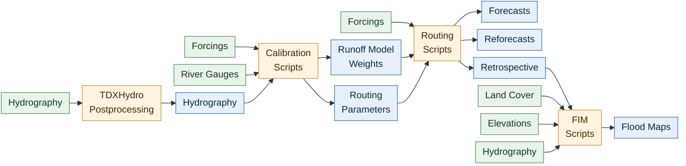
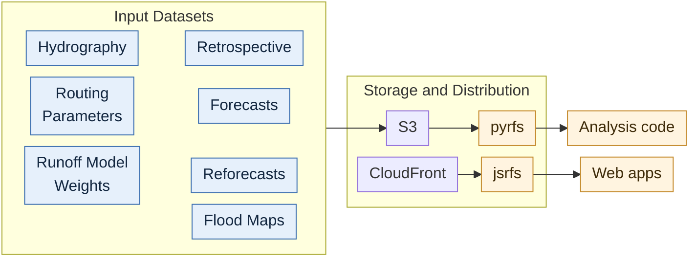

# RFS V3

This is a draft of the RFS v3 specifications. It is not complete and is subject to change.

Documentation for the River Forecast System version 3, RFS v3.

- Model Version: 3.0
- Launch Date: 1 March 2027

| Property                       | Value                                    |
|--------------------------------|------------------------------------------|
| Reference IFS Version          | 50r1                                     |
| IFS Resolution                 | O1280 grid, 0.1 degree, 9km equator      |
| Forecast Length (Lead Time)    | 15 days                                  |
| Forecast Time Step             | 3 hours                                  |
| Forecast Compute Start Time    | Typically before 0600 UTC                |
| Forecast Compute End Time      | Typically before 1200 UTC                |                         
| Retrospective Start Time       | 1940-01-01                               |
| Retrospective Update           | Daily, 00:00 UTC, available by 01:00 UTC |
| Retrospective Native Time Step | 1 hourly average                         |

## Journal Papers

- <mark>TBD</mark>

## At a glance

RFS produces 4 main datasets:

1. [Hydrography](#hydrography) and [Model Configs](#routing-configurations) (static)
2. [Retrospective simulation and derivatives](#retrospective-simulation-products)
3. [15 Day Forecasts and derivatives](#flood-forecast-products)
4. [Flood extent and depth maps](#flood-maps)

RFS data is available in the following ways:

1. [AWS S3 bucket](#organization-on-s3), `s3://river-forecast-system-v3/`
2. CloudFront Distribution, <https://d2bu4ozwm6rcbq.cloudfront.net>
3. Code packages
    1. Python: `pyrfs`, <mark>repository TBD</mark>
    2. JavaScript: [`jsrfs`](https://github.com/river-forecast-system/js-riverforecastsystem)
4. Web apps:
    1. RFS Hydroviewer, <mark>URL TBD</mark>
    2. RFS Data Store, <https://apps.geoglows.org/rfs-datastore>
5. [ArcGIS Living Atlas web map layer](#web-maps)

## Model Conceptual Diagrams

RFS v3 is shown in three parts, in order: the dependencies it is built from, which change rarely and are developed apart from the model; the RFS calculations that turn them into
products; and the storage and distribution of those products. Green is a dataset, orange is code, and blue is a product.

### Dependencies

<!-- drawn in HTML, not mermaid, because mermaid centres its rows and cannot left-align them -->
<div class="dependency-diagram">
  <div class="dependency-row">
    <div class="dependency-group"><div class="dependency-title">Code</div><div class="dependency-items"><span class="code">river-route</span><span class="code">NenCarta</span></div></div>
    <div class="dependency-group"><div class="dependency-title">River Gauges</div><div class="dependency-items"><span>Water Level</span><span>Discharge</span></div></div>
    <div class="dependency-group"><div class="dependency-title">Hydrography</div><div class="dependency-items"><span>TDX-Hydro</span><span>HydroLAKES</span><span>GLAKES</span><span>GDW</span></div></div>
  </div>
  <div class="dependency-row">
    <div class="dependency-group"><div class="dependency-title">Forcings</div><div class="dependency-items"><span>ERA5</span><span>ERA5-Land</span><span>IFS ENFO</span><span>IFS ENFH</span></div></div>
    <div class="dependency-group"><div class="dependency-title">Land Cover</div><div class="dependency-items"><span>ESA Land Cover</span><span>IHO Sea Areas</span></div></div>
    <div class="dependency-group"><div class="dependency-title">Elevations</div><div class="dependency-items"><span>FABDEM</span></div></div>
  </div>
</div>

| Group            | Dependency     | Link                                                                                                | Used in                              |
|------------------|----------------|-----------------------------------------------------------------------------------------------------|--------------------------------------|
| Code             | river-route    | [rileyhales/river-route](https://github.com/rileyhales/river-route)                                 | Calibration Scripts, Routing Scripts |
| Code             | NenCarta       | [jlgutenson/nencarta](https://github.com/jlgutenson/nencarta)                                       | FIM Scripts                          |
| River Gauges     | Water Level    | [river-forecast-system/river-gauge-data](https://github.com/river-forecast-system/river-gauge-data) | <mark>TBD</mark>                     |
| River Gauges     | Discharge      | [river-forecast-system/river-gauge-data](https://github.com/river-forecast-system/river-gauge-data) | Calibration Scripts                  |
| Forcings         | ERA5           | [ERA5 hourly, single levels](https://doi.org/10.24381/cds.adbb2d47)                                 | Calibration Scripts, Retrospective   |
| Forcings         | ERA5-Land      | [ERA5-Land hourly](https://doi.org/10.24381/cds.e2161bac)                                           | Calibration Scripts, Retrospective   |
| Forcings         | IFS ENFO       | [ENS 15-day forecast](https://www.ecmwf.int/en/forecasts/datasets/set-iii)                          | Forecasts                            |
| Forcings         | IFS ENFH       | [ENS 15-day forecast](https://www.ecmwf.int/en/forecasts/datasets/set-iii)                          | Reforecasts                          |
| Hydrography      | TDX-Hydro      | [TDX-Hydro](https://doi.org/10.22541/essoar.171629686.65893579/v1)                                  | TDXHydro Postprocessing              |
| Hydrography      | HydroLAKES     | [HydroLAKES](https://www.hydrosheds.org/products/hydrolakes)                                        | TDXHydro Postprocessing              |
| Hydrography      | GLAKES         | [GLAKES](https://doi.org/10.5281/zenodo.7016548)                                                    | TDXHydro Postprocessing              |
| Hydrography      | GDW            | [Global Dam Watch v1.0](https://doi.org/10.6084/m9.figshare.25988293.v1)                            | TDXHydro Postprocessing              |
| Elevations       | FABDEM         | [FABDEM V1-2](https://doi.org/10.5523/bris.s5hqmjcdj8yo2ibzi9b4ew3sn)                               | FIM Scripts                          |
| Land Cover       | ESA Land Cover | [ESA WorldCover](https://esa-worldcover.org/en)                                                     | FIM Scripts                          |
| Land Cover       | IHO Sea Areas  | [IHO Sea Areas v3](https://doi.org/10.14284/323)                                                    | FIM Scripts                          |

### RFS Calculations

!!! info "Datasets"
    **For the detailed list and explanation of datasets, see the following section: [Available Products](#available-products).**



| Component               | Repository                                                                                                      | Responsible                        |
|-------------------------|-----------------------------------------------------------------------------------------------------------------|------------------------------------|
| TDXHydro Postprocessing | [geoglows/tdxhydro-postprocessing](https://github.com/geoglows/tdxhydro-postprocessing)                         | Riley Hales, Rachel Huber Magoffin |
| Calibration Scripts     | [river-forecast-system/v3-calibration-scripts](https://github.com/river-forecast-system/v3-calibration-scripts) | Riley Hales                        |
| Routing Scripts         | [river-forecast-system/v3-routing-scripts](https://github.com/river-forecast-system/v3-routing-scripts)             | Riley Hales, Michael Souffront     |
| FIM Scripts             | [river-forecast-system/v3-fim-scripts](https://github.com/river-forecast-system/v3-fim-scripts)                 | Ricky Rosas, Riley Hales           |

### Data Storage and Distribution

!!! info "Datasets"
    **For the detailed list and explanation of datasets, see the following section: [Available Products](#available-products).**



| Component       | Repository                                                                                                      | Responsible                    |
|-----------------|-----------------------------------------------------------------------------------------------------------------|--------------------------------|
| pyrfs           | <mark>TBD</mark>                                                                                                | Riley Hales                    |
| jsrfs           | [river-forecast-system/js-riverforecastsystem](https://github.com/river-forecast-system/js-riverforecastsystem) | Riley Hales, Michael Souffront |
| RFS Hydroviewer | [geoglows/webapp-rfs-v3](https://github.com/geoglows/webapp-rfs-v3)                                             | Riley Hales                    |
| RFS Data Store  | [geoglows/data-store-app](https://github.com/geoglows/data-store-app)                                           | Riley Hales, Michael Souffront |

### Products not yet in this specification

Each product in the diagrams should have a short name in [Products](#products) and a section under [Available Products](#available-products). These do not:

1. **Observations.** The gauge database the fitting reads. It is an input, not a published product, but the fitted products cannot be reproduced without naming which version was used.
2. **Routing Parameters.** Published as `network.parquet` in [Routing Configurations](#routing-configurations). How a release records which fit of the equations and which
   basin calibrations made it is not described.
3. **Runoff Model Weights.** The Calibration Scripts write `runoff_correction.pt`, the trained correction, and `river_losses.parquet`, the losing rivers it was trained with
   and their losses, which production routing must apply and river-route cannot apply yet. Neither has a short name or a location in the bucket.
4. **Corrected forcings.** The RFS Calculations diagram has Routing Scripts apply the runoff weights. Whether the corrected runoff is published, or only computed on the way to routing, is not specified.
5. **Reforecasts.** No short name, layout, or schema.

Two products are in the document but have no short name: the forcings, which are in the bucket under `forcings/`, and the forecast alerts, map stylesets, and warm states, which are files
of the `forecast-15day` partition.

## Migrating from v2 to v3

This is the migration guide for consumers moving from v2 to v3, and it is the only place in this document where v3 is described in terms of v2. Every other section describes v3 on its own terms, so a
reader with no v2 history can skip ahead from here.

### Renames

These account for most of the mechanical work in porting v2 code.

| v2                                                         | v3                    | Notes                                                                     |
|------------------------------------------------------------|-----------------------|---------------------------------------------------------------------------|
| `rivid` (forecasts from RAPID), `river_id` (retrospective) | `riverId`             | One name in every product, where v2 used a different spelling per product |
| `Qout`                                                     | `Q`                   | One name in every product, including the ensemble arrays                  |
| `return_period`                                            | `recurrence_interval` | Now `float32`, not int, because the axis carries a 1.5 year value         |

### Reading discharge values

- **`riverId` is the first dimension now, not `time`.** Every discharge array is `(riverId, time)` where v2 was `(time, riverId)`, so an indexed read becomes `Q[river, time]`. Code that reads through
  xarray by dimension name needs no change; code that indexes by position does. See [Chunking and sharding](#chunking-and-sharding)
- **Discharge is bitrounded `float32`. Precision is now relative rather than absolute, see [Encoding and compression](#encoding-and-compression)
- **`riverId` order is now a formal promise.** The axis is topologically sorted and identical across every product. It is not ascending id order, so an id cannot be located by binary search on the
  published array. The new `riverIndex` attribute on the streams gives a river's position directly, which avoids a lookup when downloading
- **Flow duration curves are `float32` and bitrounded** like every other discharge array. v2 stored them as `float64`
- Streams carry additional attributes, and some renamed ones, which make the data more self documenting and convenient to use. Hydrography geometry is now EPSG:3857, not EPSG:4326,
  see [Geometry storage](#geometry-storage)

### New in v3

- Confluences, catchments, and region outlines published per region, plus a global attribute table (`metadata.parquet`, `metadata.zarr`)
- The edits the pipeline made to TDX-Hydro are published alongside the network as `region=<id>/mods/`, so a source reach can be traced to the v3 reach that represents it
- `riverIndex` and `upstreamCount` on every reach: the reaches upstream of any reach are the contiguous row range `[riverIndex - upstreamCount, riverIndex]` in every table and every Zarr
- Lake and reservoir routing: lakes and reservoirs are handled in the network itself: interior reaches are removed, inlets point at the outlet, and the outlet reach carries a traced line through
  the lake. There is no separate lakes layer, see [Lakes and reservoirs](#lakes-and-reservoirs)
- The 1.5 year recurrence interval and a derived `annual_exceedance_probability` array on the return periods
- Flood maps: forecast flood extents and return period flood maps, tiled by 1x1 degree, see [Flood Maps](#flood-maps)
- Routing calibration: Muskingum k and x calibrated against observed discharge, see [RFS Calculations](#rfs-calculations)
- Runoff calibration: the land surface model runoff is corrected by a model trained against observed discharge in the Calibration Scripts, see [RFS Calculations](#rfs-calculations)
- An official JavaScript package, [`jsrfs`](https://github.com/river-forecast-system/js-riverforecastsystem), for reading the published Zarr stores
- A CloudFront distribution serving the whole bucket over HTTPS, <https://d2bu4ozwm6rcbq.cloudfront.net>, see [Data Organization](#data-organization)

### Discontinued in v3

- The forecast records product
- The "52nd ensemble member" IFS HRES, so the `member` axis runs 0..50, ECMWF's own numbering, with nothing off axis. HRES was discontinued after becoming identical to the control forecast
    - <https://www.ecmwf.int/en/about/media-centre/focus/2024/plans-high-resolution-forecast-hres-and-ensemble-forecast-ens>
- The https://geoglows.ecmwf.int web portal is retired

### Model changes behind the numbers

These change the values themselves rather than how they are read, so a difference between v2 and v3 at a given river is expected.

- Forecasts and retrospective simulations are tightly coupled using shared initializations
- Reduction in total stream count from about 6.8 million to about 4.92 million, for computational efficiency and accuracy, better treatment of lakes and reservoirs, and reduction in total storage
  burden. Streams in the middle of deserts, within lakes, in oceans, on small islands, in terminal watersheds under 250 km2, and reaches shorter than 2 km were removed or merged, see
  [Network simplification](#network-simplification)
- Upgrading to use the newest IFS version, 50r1
- Runoff volumes are aggregated to catchment scale on the native octahedral, or reduced gaussian, mesh native to the IFS version instead of being resampled to a uniform lat/lon grid
- Upgrade computations to use river-route (Python) instead of RAPID (user compiled Fortran) for matrix muskingum routing, with synthetic reach subdivision for greater computational stability
- Application of bitrounding to 13 keepbits, which compresses much better, but data are modified after computation

## Available Products

### Data Organization

- All v3 data are under a single bucket, `s3://river-forecast-system-v3/`, served through the CloudFront CDN at `https://d2bu4ozwm6rcbq.cloudfront.net`.
- Within each product, subdivisions use hive partition style names
    - Hydrography is organized by HydroBASINS level 2 region, `region=<id>`, e.g. `region=1020000010`, with the products that span every region in `hydrography/global/`
    - Routing configurations are organized by the same regions in a tree of their own, `routing/region=<id>`, derived from the hydrography but not published in it
    - Forecasts are organized by a sequence of year, month, day dividers: `year=YYYY/month=MM/day=DD`
    - Flood maps are organized by 1x1 degree tiles labeled by latitude and longitude: `lat=YYY/lon=XXX`
- The runoff forcings the router reads are kept in the bucket under `forcings/`: ERA5 one Zarr per year, `era5/YYYY.zarr`, and IFS one directory of GRIB files per initialization,
  `ifs/YYYYMMDDHH/`
- Monthly and yearly averages are available in timeseries and timestep chunked forms in a single zarr

### Products

Each product with a short name has one unique within this model version and stable across releases. The data store addresses a product's page as
`/rfs-data-store/datasets/v3/<short name>`, so the name is a permalink. Names are lower case and hyphenated, and say what the product is rather than where it is filed. Times are UTC.

| Short name                 | Product                  | Category                  | Format              | Updated                                   | Size               |
|----------------------------|--------------------------|---------------------------|---------------------|-------------------------------------------|--------------------|
| `streams`                  | Stream centerlines       | Hydrography               | GeoParquet          | Per release                               | ~15 GB, every regional hydrography file |
| `catchments`               | Catchment boundaries     | Hydrography               | GeoParquet          | Per release                               |                    |
| `confluences`              | Confluence points        | Hydrography               | GeoParquet          | Per release                               |                    |
| `lakes`                    | Lakes                    | Hydrography               | GeoParquet          | Per release                               |                    |
| `metadata`                 | Stream attributes        | Hydrography               | Parquet, Zarr       | Per release                               | ~215 MB + ~70 MB   |
|                            | Stream tiles             | Hydrography               | PMTiles             | Per release                               | ~3.2 GB            |
|                            | Catchment tiles          | Hydrography               | PMTiles             | Per release                               | <mark>TBD</mark>   |
|                            | Region tiles             | Hydrography               | PMTiles             | Not built                                 |                    |
|                            | Modification records     | Hydrography               | JSON                | Per release                               | ~165 MB            |
| `routing-configs`          | River-route configs      | Model Configs             | Parquet, netCDF     | Per release                               | ~1.5 GB            |
| `retrospective-hourly`     | Hourly discharge         | Retrospective             | Zarr                | Daily, by 01:00                           | 10 TB              |
| `retrospective-daily`      | Daily discharge          | Retrospective             | Zarr                | Daily, by 01:00                           | 500 GB             |
| `retrospective-monthly`    | Monthly discharge        | Retrospective             | Zarr                | Monthly, the 5th, by 01:00                | ~20 GB             |
| `retrospective-yearly`     | Yearly discharge         | Retrospective             | Zarr                | Yearly, January 5, by 01:00               | ~2 GB              |
| `annual-maximums-hourly`   | Annual maximums (hourly) | Retrospective             | Zarr                | Yearly, January 5, by 01:00               | ~1 GB with daily   |
| `annual-maximums-daily`    | Annual maximums (daily)  | Retrospective             | Zarr                | Yearly, January 5, by 01:00               |                    |
| `return-periods`           | Return periods           | Retrospective             | Zarr                | Per release                               |                    |
| `flow-duration-curves`     | Flow duration curves     | Retrospective             | Zarr                | Per release                               |                    |
| `forecast-15day`           | 15-day ensemble forecast | Forecasts                 | Zarr                | Daily 00:00 run, by 06:00-12:00           | ~61 GB             |
|                            | Map stylesets            | Forecasts                 | bin + JSON          | Daily, with the forecast                  |                    |
|                            | Alerts                   | Forecasts                 | CSV                 | Daily, with the forecast                  | 500 MB             |
|                            | Esri animation tables    | Forecasts                 | CSV                 | Daily, with the forecast                  | 120 x 120 MB       |
|                            | Warm states              | Forecasts                 | Parquet             | Daily, with the forecast                  |                    |
| `forecast-flood-maps`      | Forecast flood maps      | Flood maps, Forecasts     | GeoParquet, GeoTIFF | Daily, with the forecast                  | <5 GB              |
| `return-period-flood-maps` | Return period flood maps | Flood maps, Retrospective | GeoTIFF             | Per release                               | <10 GB             |
| `fldpln-libraries`         | FLDPLN libraries         | Flood maps                | Parquet, Zarr       | Per release                               |                    |

### Organization on S3

The bucket is `s3://river-forecast-system-v3/`. The same tree is served over HTTPS by the CloudFront CDN at `https://d2bu4ozwm6rcbq.cloudfront.net`, so `s3://river-forecast-system-v3/<key>` is read
as `https://d2bu4ozwm6rcbq.cloudfront.net/<key>`.

```text
s3://river-forecast-system-v3/
├── hydrography/
│   ├── global/                                 # the products that span every region
│   │   ├── metadata.parquet                    # every reach's attributes, all regions concatenated in riverIndex order
│   │   ├── metadata.zarr/                      # the network walking columns as chunked arrays, for browser clients
│   │   ├── streams.pmtiles                     # z0-11, for mapbox-gl-js, maplibre, leaflet, etc
│   │   ├── catchments.pmtiles                  # catchment polygons and boundaries, for the same clients
│   │   ├── regions.pmtiles                     # z0-12, region outlines - NOT CURRENTLY BUILT
│   │   ├── tdxhydro_to_v3_id_map.parquet       # optional, every source TDX-Hydro reach to the v3 reach representing it
│   │   └── streams_map_optimized.gdb.zip       # for esri map layers - not produced by the hydrography pipeline, TBD
│   └── region=<id>/                            # all geometry epsg3857 snapped to a 1 m grid, geoarrow geoparquet 1.1
│       ├── streams_<id>.geo.parquet            # TDX-Hydro derived - the only streams product, full attribute table
│       ├── metadata_<id>.parquet               # the streams' attribute table without geometry, plus outlet lat/lon
│       ├── catchments_<id>.geo.parquet         # TDX-Hydro derived - one polygon per reach
│       ├── confluences_<id>.geo.parquet        # TDX-Hydro derived - junction points
│       ├── boundary_<id>.geo.parquet           # the region's outline
│       ├── mods/                               # the edits made to TDX-Hydro, the provenance of this network
│       │   ├── lake_edits.json
│       │   ├── zero_length_streams.json
│       │   ├── coastal_orphans.json
│       │   ├── headwater_dissolves.json
│       │   ├── branches_to_prune.json
│       │   └── short_consolidations.json
│       └── synthetic_rating_curve.parquet      # from ARC, for routing, FIM? Q_baseflow depends on a modeled value! - TBD
├── routing/                                    # routing configurations, made by the Calibration Scripts from hydrography/
│   ├── global/                                 # every region's files concatenated in riverIndex order, to route the world at once
│   │   ├── network.parquet
│   │   ├── gridweights_ERA5_global.nc
│   │   ├── gridweights_ERA5_global.parquet
│   │   ├── gridweights_ERA5Land_global.nc
│   │   ├── gridweights_ERA5Land_global.parquet
│   │   └── gridweights_O1280_global.nc
│   └── region=<id>/                            # the regions of hydrography/, rivers in the same riverIndex order
│       ├── network.parquet                     # the Routing Parameters: calibrated Muskingum k/x and connectivity, for river-route
│       ├── gridweights_ERA5_<id>.nc            # runoff grid to catchment weights, one per forcing grid, the standard format
│       ├── gridweights_ERA5_<id>.parquet       # an extra copy of the ERA5 weights, in the layout jsrr reads fastest
│       ├── gridweights_ERA5Land_<id>.nc        # ERA5-Land, 0.1 degree
│       ├── gridweights_ERA5Land_<id>.parquet
│       └── gridweights_O1280_<id>.nc           # IFS reduced gaussian grid weights, for the forecasts and reforecasts
├── forcings/                                   # the runoff the router reads, see Model Conceptual Diagrams
│   ├── era5/
│   │   └── YYYY.zarr/                          # Zarr v3, ro only, chunks 16 x 16 on lat/lon and the whole year on time
│   └── ifs/
│       └── YYYYMMDDHH/                         # one directory per forecast initialization
│           └── <filename>.grib                 # the IFS GRIB files for that initialization
├── retrospective/
│   ├── hourly.zarr/
│   ├── daily.zarr/
│   ├── monthly.zarr/                           # holds both Q and Q_timesteps
│   ├── yearly.zarr/                            # holds both Q and Q_timesteps
│   ├── return-periods.zarr/
│   ├── maximums.zarr/
│   └── fdc.zarr/
├── flood-maps/
│   └── lon=XXX/
│       └── lat=YYY/
│           ├── return_period_maps/
│           │   ├── rp2.tif
│           │   ├── rp5.tif
│           │   ├── rp10.tif
│           │   ├── rp25.tif
│           │   ├── rp50.tif
│           │   └── rp100.tif
│           ├── arc/
│           │   ├── vdt.parquet
│           │   └── representative_xsections.parquet
│           └── fldpln/
│               ├── fldpln_library.parquet
│               ├── stream_info.parquet
│               └── fldpln.zarr/
│                   ├── library/
│                   ├── streams/
│                   └── zarr.json
└── forecasts15/                                # 15 day @ 3 hour forecasts, lead_time coordinate alongside absolute time
    └── year=YYYY/
        └── month=MM/
            └── day=DD/
                ├── alerts.csv                  # for CAP alerts
                ├── maps/                       # summary files
                │   ├── esri_animation_tables/  # for animated forecast layer (arcgis living atlas)
                │   │   ├── YYYYMMDDHH.csv
                │   │   └── x120...
                │   ├── timeseries/
                │   │   ├── styles.bin
                │   │   └── styles.json
                │   ├── max-flow/
                │   │   ├── styles.bin
                │   │   └── styles.json
                │   ├── below-q95/
                │   │   ├── styles.bin
                │   │   └── styles.json
                │   └── time-to-peak/
                │       ├── styles.bin
                │       └── styles.json
                ├── next-init-files/                # routing warm states, the next run's initialization
                │   └── group=XXX/
                │       └── warmstate_YYYYMMDDHHMM_groupXXX.parquet
                ├── discharge.zarr/                 # 15 day discharge of the 50+1 ensemble, see Zarr structuring
                └── fim.geo.parquet             # vector extent polygons, faster/smaller, single file
```

### Hydrography

| Property            | Value                                                                              |
|---------------------|------------------------------------------------------------------------------------|
| Streams (reaches)   | ~4.92 million (4,917,183 in the current build)                                     |
| Partition           | 47 TDX-Hydro regions (HydroBASINS level 2 ids, e.g. `1020000010`)                  |
| Terminal watersheds | 12,446                                                                             |
| Reference product   | TDX-Hydro                                                                          |
| Preparation code    | [`tdxhydro-postprocessing`](https://github.com/geoglows/tdxhydro-postprocessing), see its README |

Hydrography is divided by **HydroBASINS level 2 region**, written into the bucket as a `region=<id>` hive partition, with the products that span every region in `hydrography/global/`.

Its files are listed in [Organization on S3](#organization-on-s3). The routing configurations derived from this network are published apart from it, see [Routing Configurations](#routing-configurations).

The row order, attribute schema, geometry storage, lakes, network simplification, modification records, and vector tiles are explained in the
[Technical Appendix](#hydrography-details).

### Routing Configurations

The files the router needs to route a region, short name `routing-configs`, are published under `routing/`, partitioned by the same `region=<id>` as the hydrography and kept apart from it.
They are the exact files used to generate official routing outputs. They are made by the Calibration Scripts
([`v3-calibration-scripts`](https://github.com/river-forecast-system/v3-calibration-scripts)) from the published hydrography after it is built, which they only read, so a new
forcing grid changes `routing/` and never `hydrography/`. The hydrography carries no routing configuration. The Routing Scripts only read `routing/`.

- `1_inputs/` writes the grid weights of every forcing.
- `2_routing_calibration/` writes the Routing Parameters, the calibrated Muskingum k and x in `network.parquet`, see [RFS Calculations](#rfs-calculations): the regional
  equations of celerity by drainage area give every river its baseline k, and the rivers upstream of a gauge take the k of their basin's
  calibration, one celerity multiplier per stretch between gauges, fitted from upstream down so that no gauge's KGE falls. x is 0.2 everywhere.

Its files are listed in [Organization on S3](#organization-on-s3). `routing/global/` holds every region's file concatenated in `riverIndex` order, nothing recomputed, so the
whole world can be routed in one process, which reads a forecast's GRIB files once rather than once per region.

Every file lists the region's rivers in `riverIndex` order, which is topological. The router pairs weights with rivers by position, not by id: lateral inflow column i is routed into river i, so
a region's files must agree with each other and with the hydrography's row order.

`network.parquet` is river-route's network file, one row per reach: `riverId`, `nextRiverId`, `riverIndex` and `upstreamCount` from the metadata and
streams tables, and `muskingumK` (seconds) and `muskingumX`. `gridweights_<grid>_<id>.nc` is one row per runoff-cell-to-catchment intersection, stamped with the grid file and the catchments it was cut
from. It is named for the forcing grid, so each grid needs its own. On the regular ERA5 grid its columns are `river_id`, `x_index`, `y_index`, `x`, `y`, `area_sqm`, `proportion`. On the
IFS reduced gaussian grid, `O1280`, a cell is located by `cell_index`, its position in the values of a GRIB message, in place of `x_index` and `y_index`: `river_id`, `cell_index`, `x`,
`y`, `area_sqm`, `proportion`, as `river_route.runoff.reduced_grid_weights` writes it, and the forecast GRIB files are routed as they are, with river-route's `ecmwf_grib` forcing.
The ensemble forecasts (ENFO) and the reforecasts (ENFH) are both on `O1280`, so its weights serve both.

`gridweights_<grid>_<id>.parquet` holds the netCDF's rows without `x` and `y`, which jsrr does not read: `river_id`, `x_index` and `y_index` as int32, `area_sqm` and `proportion` as float32,
snappy compressed, without dictionary encoding, in one row group. jsrr refuses a
region unless every river in `network.parquet` has a weight and every weight names one of its rivers.

### Flood Forecast Products

The daily 15-day forecast is published under `forecasts15/`, partitioned `year=YYYY/month=MM/day=DD/`, with the files listed in
[Organization on S3](#organization-on-s3): `discharge.zarr`, the map stylesets (see [Forecast map stylesets](#forecast-map-stylesets)), `alerts.csv` (see
[Forecast alerts](#forecast-alerts)), the Esri animation tables, `fim.geo.parquet`, the vector flood extents, and the routing warm states for the next run.

The forecast discharge store contains

1. `Q` (riverId, member, time): 3 hourly discharge for each of the 50+1 IFS forecast members, `member` 0 the control forecast and 1..50 the perturbed forecasts of the same number
2. `Qpercentiles` (riverId, percentiles, time): 3 hourly discharge ensemble at deciles 0 (min), 10, 20 ... 50 (median) ... 90, 100 (max)
3. `Qmean` (riverId, time): 3 hourly discharge ensemble mean

### Retrospective Simulation Products

The retrospective stores are listed in [Products](#products) and laid out in [Zarr structuring](#zarr-structuring).

Routing warm states are not stored under `retrospective/`. They are written per computational unit with the forecast that consumes them, at
`forecasts15/year=YYYY/month=MM/day=DD/next-init-files/group=XXX/warmstate_YYYYMMDDHHMM_groupXXX.parquet`.

### Flood Maps

Flood maps are tiled, partitioned `flood-maps/lon=XXX/lat=YYY/`. Each tile holds the return period flood maps, the ARC tables, and the FLDPLN library used by the flood worker.

| File                                          | Format  | Description                                                |
|-----------------------------------------------|---------|------------------------------------------------------------|
| `return_period_maps/rp{2,5,10,25,50,100}.tif` | GeoTIFF | Flood map for each return period, 2 to 100 years           |
| `arc/vdt.parquet`                             | Parquet | ARC velocity, depth, and top width table                   |
| `arc/representative_xsections.parquet`        | Parquet | ARC representative cross sections                          |
| `fldpln/fldpln_library.parquet`               | Parquet | FLDPLN library                                             |
| `fldpln/stream_info.parquet`                  | Parquet | FLDPLN stream information                                  |
| `fldpln/fldpln.zarr/`                         | Zarr v3 | Per tile FLDPLN library, read directly by the flood worker |

The daily forecast also publishes vector flood extents as a single `fim.geo.parquet` per forecast, which is faster and smaller than a raster set for map clients. See
[Flood Forecast Products](#flood-forecast-products).

The internal layout of `fldpln.zarr` is documented in the [Technical Appendix](#flood-mapslonxxxlatyyyfldplnzarr).

### Web Maps

1. Daily forecasted flood maps [https://www.arcgis.com/home/item.html?id=8f0573e0c0b9491dbeafde9c72ccf02b](https://www.arcgis.com/home/item.html?id=8f0573e0c0b9491dbeafde9c72ccf02b)
2. Return period flood maps and/or forecasted flood maps (ESRI)
    1. Return period flood maps
    2. Daily forecast flood maps, from the 90th percentile of the ensemble maximum

## Open Questions

- **Modification records format.** The `mods/` files are raw JSON, ~165 MB uncompressed across the release, in directories where everything else is zstd geoparquet tuned for range fetches. They cannot be range-fetched and a consumer wanting the survivor map parses all 282 of them. A single parquet per region — `{member, keeper, editKind}`, dictionary encoded — would be a fraction of the size and read with the same tooling as the rest of the partition. Deferred, not urgent.
- **Region tiles.** Only `streams.pmtiles` is built. `tile_regions.sh` is commented out of `pipeline.sh`. Decide whether it returns or is dropped from v3; [Vector tiles](#vector-tiles) describes the design.
- **Warm state partition.** `forecasts15/.../next-init-files/group=XXX/` names a unit that no longer exists. The hydrography computational group was removed, so a warm state is no longer partitioned by anything the hydrography publishes. Decide what the router writes instead — `region=<id>` to match the hydrography partition, or a unit of its own choosing. The same question applies to `fim.geo.parquet` "for all groups".

## Design Notes

Why some of the choices above were made, for those changing them.

- **Row order.** Descending the largest subtree first is the exact minimizer of the distance between a reach and the reach it drains into over every post-order: a mean of 3.5 rows against 135.3 unordered, the 99th percentile 28 against 1,451, over all 3.89 million edges. Both the compressor and the routing kernel use that locality.
- **Geometry storage.** Snapping to a 1 m grid leaves about 30 trailing zero mantissa bits in every float64 coordinate; geoarrow keeps x and y in separate columns and `BYTE_STREAM_SPLIT` groups the zero bytes so zstd collapses them, cutting the hydrography 60-70%. None helps alone, and no decimal degree grid is a power of two. zstd level 3 reaches the locality the row order creates: 380 MB against 1,247 MB unordered with snappy on one 352,529 reach region.
- **Chunking.** On a real group, one river per chunk compressed 2.85x and read one river in 1.5 ms, against 2.16x and 2.8 ms at ten rivers per chunk, because wider C-order chunks interleave rivers and break the series' autocorrelation. A short series of one river is 28 to 480 bytes, about the 32 bytes of blosc header and index entry a chunk costs, so short arrays hold 250 or 1,000 rivers a chunk; one-river chunks of yearly `Q` would make a shard index 800 KB instead of 3 KB.
- **`riverId` first.** With one river per chunk, `(1, n_time)` and `(n_time, 1)` chunks are byte for byte the same on disk; river-first only spares every writer a transpose.
- **One keepbits.** Rounding is idempotent at a fixed keepbits, so every derived store matches the hourly values exactly and a daily mean can be reproduced by resampling the hourly store.

## Implementation Details

### Log/Status Feeds

In addition to writing logging messages to disc, status information is sent to the following locations:

- Teams channel webhook
- AWS CloudWatch logs

## Technical Appendix

Expanded explanations of the products summarized in the sections above.

### Hydrography details

#### Row order, `riverIndex`, and `upstreamCount`

Every hydrography table is in one global row order, and that order is the `riverId` axis of every Zarr store. `riverIndex` is a reach's row position in that order; `upstreamCount` is the number of
reaches strictly upstream of it.

**The ordering is topological first.** Every reach lands after every reach that drains into it. Everything below is a tie-break, consulted only where topology constrains nothing. The global order is
the regions concatenated in **ascending level 2 region number** — that is the whole of it, there is no coarser key and nothing to look up — and within a region the order is nested two levels deep:

1. **Terminal watersheds, along a Hilbert curve through their outlet points** (16 bit index on the outlet lon/lat). Watersheds are disjoint components, so their order among themselves is
   unconstrained, and putting neighboring basins next to each other in the file is what keeps the geometry compressible and the tiles coherent.
2. **Reaches within a watershed, depth first post-order from the outlet, descending the largest subtree first.** Post-order emits a reach after everything upstream of it, so this is still a valid
   topological sort, and a subtree occupies a contiguous interval that ends at its root.

Three promises follow, and each is asserted by the build rather than assumed:

- **Upstream before downstream.** Every reach is ordered after every reach that drains into it.
- **Every upstream subset is one contiguous row range**, exactly `[riverIndex - upstreamCount, riverIndex]`. An upstream query is a range filter, on any table or any Zarr.
- **Every region is one contiguous row range**, so a region's rows are a slice of the global tables and a routing engine can treat a region file as a dense array whose local index is
  `riverIndex - riverIndexStart`. The same holds for every terminal watershed.

Because the order is topological, not ascending by id, an id cannot be found by binary search on the published `riverId` array; read `riverIndex` off the streams or metadata instead.

`riverIndex` is positional and **not stable across rebuilds**. `riverId` is the only stable identifier; it is the TDX-Hydro `LINKNO` plus a per region offset that makes it globally unique.

#### Attribute schema

`metadata_<id>.parquet` and `streams_<id>.geo.parquet` carry the same rows in the same order; the streams add `geometry` and omit `lat`/`lon`. `global/metadata.parquet` is every region's metadata
concatenated, the same columns. Column order puts the network walking columns first so a projected read of them is one contiguous run of column chunks.

| Column            | Type     | Description                                                                                |
|-------------------|----------|--------------------------------------------------------------------------------------------|
| `riverId`         | int32    | Unique reach id, the TDX-Hydro `LINKNO` offset per region.                                 |
| `nextRiverId`     | int32    | Downstream reach id, -1 at an outlet                                                       |
| `outletRiverId`   | int32    | The terminal outlet reach of this reach's watershed                                        |
| `riverIndex`      | int32    | Row position in the global order, see above.                                               |
| `upstreamCount`   | int32    | Reaches strictly upstream; they are rows `[riverIndex - upstreamCount, riverIndex]`        |
| `strahlerOrder`   | int32    | Strahler stream order, from TDX-Hydro `strmOrder`, taking the max when reaches were merged |
| `shreveOrder`     | int32    | Shreve magnitude, the upstream headwater count recomputed on the simplified network.       |
| `USContArea`      | float64  | Contributing area at the reach's upstream end, m2, from TDX-Hydro                          |
| `DSContArea`      | float64  | Contributing area at the reach's downstream end, m2, from TDX-Hydro                        |
| `areaM2`          | float64  | The reach's own catchment area, m2, `DSContArea - USContArea`                              |
| `Length`          | float64  | Reach length, m, the TDX-Hydro TauDEM length summed over merged reaches                    |
| `TDXHydroRegion`  | string   | Source TDX-Hydro region id                                                                 |
| `lat`             | float64  | Outlet point of the reach in degrees, EPSG:4326.                                           |
| `lon`             | float64  | Outlet point of the reach in degrees, EPSG:4326.                                           |
| `geometry`        | geoarrow | The reach line, MultiLineString, EPSG:3857. **Streams only**                               |

#### Confluences

`confluences_<id>.geo.parquet`, one row per reach that has at least one reach draining into it, in the same `riverIndex` order as the reaches, row groups of 2,000.

| Column         | Type     | Description                                                           |
|----------------|----------|-----------------------------------------------------------------------|
| `riverId`      | int32    | The reach that begins at this junction, i.e. the downstream reach     |
| `upstream_ids` | string   | Comma separated `riverId`s of the reaches meeting here                |
| `geometry`     | geoarrow | Point, EPSG:3857, the outlet point of the first listed upstream reach |

#### Catchments

`catchments_<id>.geo.parquet`, one polygon per reach, in the same order as the reaches, so one selector addresses both.

| Column       | Type     | Description                                                                                                  |
|--------------|----------|--------------------------------------------------------------------------------------------------------------|
| `riverId`    | int32    | The reach this catchment drains to                                                                           |
| `riverIndex` | int32    | The reach's row position, identical to the streams                                                           |
| `geometry`   | geoarrow | MultiPolygon, EPSG:3857, the TDX-Hydro source basins of every reach merged into this one, dissolved together |

The catchments are the TDX-Hydro `streamreach_basins` polygons dissolved along exactly the edits made to the stream network, so a catchment covers the drainage of everything that was merged into its
reach and the catchment coverage conserves area. They are then coverage simplified at 20 m with the outer boundary pinned, a few times the 3.4 m cell of the DEM they were polygonized from, which removes the raster staircase
and little else.

#### Region outlines

`boundary_<id>.geo.parquet` is a single MultiPolygon, the union of every catchment in the region, with interior holes exactly where the release dropped watersheds. The outlines are
exact rather than simplified: adjacent regions share edges instead of overlapping, and the build logs any overlapping pair.

#### Geometry storage

Every geometry product in the bucket — streams, catchments, confluences, outlines — is stored the same way.

| Property                   | Value                                                                                                                    |
|----------------------------|--------------------------------------------------------------------------------------------------------------------------|
| CRS                        | EPSG:3857 (web mercator)                                                                                                 |
| Coordinate grid            | snapped to 1 m                                                                                                           |
| GeoParquet version         | 1.1                                                                                                                      |
| Geometry encoding          | geoarrow (native), **not** WKB                                                                                           |
| Geometry types             | streams MultiLineString, confluences Point, catchments and outlines MultiPolygon                                         |
| Coordinate column encoding | `BYTE_STREAM_SPLIT`, dictionary encoding off                                                                             |
| Compression                | zstd level 3                                                                                                             |
| Row group size             | 500 rows for streams and catchments; 2,000 for metadata and confluences; pyarrow's default for `global/metadata.parquet` |


Snapping moves a vertex at most 0.71 m, inside the 3.4 m resolution of the source DEM. `Length`, `areaM2` and the contributing areas come from the source, not the projected geometry, and
`lat`/`lon` stay in degrees.

Stream geometry is otherwise at source resolution: the published streams are not simplified, and the tiles generalize per zoom. The one exception is the traced line through a lake.

Consumers who need geographic coordinates must reproject; the inverse transform returns degrees to within the 1 m snap.

#### Lakes and reservoirs

A version controlled lake table lists each lake's inlet reaches and its single outlet reach. For each lake

- every reach in the interior between the inlets and the outlet is removed from the network and its catchment area (`areaM2`) folded into the outlet, so drained area is conserved;
- inlets whose contributing area (`DSContArea`) is below 100 km2 are too small to route into the lake on their own, so their whole upstream branch is absorbed into the lake as well;
- the surviving inlets point directly at the outlet, i.e. `nextRiverId` is the outlet;
- the outlet reach's geometry becomes the line traced from each significant inlet (Strahler order 4 or more, plus each lake's largest inlet) through the lake to the outlet, merged into a
  MultiLineString when there is more than one, and generalized at 100 m because it is a synthetic line across open water rather than a surveyed channel;
- the outlet reach is protected from every other simplification step, so it keeps its identity and its short length.

A lake therefore appears as one reach with a branched line through it, and the catchment of that reach is the lake plus the drainage of everything absorbed into it.

#### Network simplification

The published network is smaller than TDX-Hydro because, per region and in this order, the pipeline

1. drops whole terminal watersheds on the version controlled drop lists: no-runoff basins in the Sahara, Gobi, and Australian interior, small islands, small ocean draining watersheds, and manually
   excluded watersheds;
2. drops every remaining terminal watershed whose outlet contributing area is under 250 km2;
3. applies the lake edits above;
4. repairs zero length reaches, which the source DEM processing leaves at some confluences and coasts;
5. folds orphaned coastal order 1 reaches into the neighbor they shared a confluence with;
6. dissolves order 2 headwaters whose upstreams are all order 1 into a single reach;
7. folds order 1 reaches that join an order 2 or higher reach into a sibling at the same confluence, moving area but not geometry;
8. consolidates reaches shorter than 2 km into a neighbor that is not separated from them by a confluence, so routing is numerically stabler and fewer results are stored.

Every edit is recorded as a keeper to members mapping and replayed on the catchments, so the catchment coverage matches the published network exactly, and an original TDX-Hydro reach can be mapped to
the v3 reach that now represents it. Those records are published, see below.

#### Modification records

`region=<id>/mods/` holds the edits the pipeline made to the source TDX-Hydro, the provenance of the network: the only record of which source reach a published reach absorbed.

| File                        | Shape                                 | Written by                                                   |
|-----------------------------|---------------------------------------|--------------------------------------------------------------|
| `lake_edits.json`           | `{outlet: {delete: [...], ...}}`      | The lake edits, interior reaches folded into the lake outlet |
| `zero_length_streams.json`  | `{case1\|case2\|case3: {ids: [...]}}` | Zero length reach repair, by case                            |
| `coastal_orphans.json`      | `{keeper: [members]}`                 | Orphaned coastal order 1 reaches                             |
| `headwater_dissolves.json`  | `{keeper: [members]}`                 | Order 2 headwater dissolves                                  |
| `branches_to_prune.json`    | `{keeper: [members]}`                 | Pruned order 1 branches                                      |
| `short_consolidations.json` | `{keeper: [members]}`                 | Reaches shorter than 2 km folded into a neighbour            |

Every id is a source TDX-Hydro reach id in the same namespace as `riverId`, so the files join directly against the published network. Each reach is removed at most once across every edit, so the
union of the maps cannot collide. A keeper may itself be a member of a later edit, so chains must be followed transitively to a terminal survivor; the edits only ever fold a reach downstream, so the
chains form a DAG and the walk terminates. Three outcomes are possible for a source id and a consumer has to tell them apart: it is published unchanged, it resolves through a chain to a keeper, or it
resolves to nothing because it was removed outright — a dropped watershed, a sub-250 km2 terminal, a zero length reach. Only the last is an error, and only the consumer knows whether it is fatal.

`global/tdxhydro_to_v3_id_map.parquet` is that resolution precomputed for every source reach in every region, about 16 million rows, `riverId` null where the reach has no v3 representation. It is
optional and is not written by default.

#### Vector tiles

Three tilesets are specified in `global/`, all built with tippecanoe from the parquet products above, so there is no second simplified copy of any geometry.

| Tileset           | Zooms | Layers    | Notes                                                                                                                                                                                                                                                                                              |
|-------------------|-------|-----------|----------------------------------------------------------------------------------------------------------------------------------------------------------------------------------------------------------------------------------------------------------------------------------------------------|
| `streams.pmtiles` | 0-11  | `streams` | Tiled per region then joined. Carries every attribute except `USContArea`. Reaches appear by Strahler order: 7+ at every zoom, 6+ from z5, 4+ from z7, 2+ from z9; order 1 reaches are not tiled at any zoom; the densest tiles drop features as needed |
| `catchments.pmtiles` | <mark>TBD</mark> | `catchments`, `catchment_lines` | Catchment polygons for fills and hit testing, and their boundaries for strokes, tiled in zoom bands, see below |
| `regions.pmtiles` | 0-12  | `regions` | The region outlines with `TDXHydroRegion`. **Not currently built**                                                                                                                                                                                                                                 |

Every catchment band is tiled twice: `catchments` holds the polygons for fills and hit testing, and `catchment_lines` holds their boundaries for strokes. Clipping a polygon to a tile has to close the
ring along the tile edge, so stroking the polygon layer draws the tile grid across the map; clipping a line does not. **Style fills from `catchments` and strokes from `catchment_lines`, never stroke
the polygon layer.** Each band's geometry is cut at a quarter pixel of the band's finest zoom, rounded to a power of two (32 m for the z10 leaf, 64 m at z9, and so on), and tippecanoe generalizes
again per zoom on top of that.

### Zarr structuring
Every store is **Zarr v3**. The river axis is named `riverId`, discharge is named `Q`, and **`riverId` is the first dimension of every array** — `(riverId, time)`, not the `(time, riverId)` v2 used.
Chunking and sharding are fixed for every store, see [Chunking and sharding](#chunking-and-sharding); the schematics below repeat what that section sets.

#### Datatypes

Only discharge valued arrays are bitrounded.

| Array                                                   | Dtype     | Bitrounded | Notes                                    |
|---------------------------------------------------------|-----------|------------|------------------------------------------|
| `riverId`                                               | `int32`   | no         | ids exceed int16, well inside int32      |
| `time`                                                  | `int32`   | no         | integer hours, see below                 |
| `member`                                                | `int32`   | no         | forecasts only, 0..50                    |
| `lead_time`                                             | `int32`   | no         | forecasts only, `units "hours"`          |
| `Q`, `Q_timesteps`                                      | `float32` | **yes**    | m3 s-1, 13 keepbits                      |
| `daily`, `hourly`                                       | `float32` | **yes**    | maximums.zarr annual maxima              |
| `{gumbel,logpearson3,lognormal,weibull}_{hourly,daily}` | `float32` | **yes**    | return-periods.zarr, 8 arrays            |
| `max_simulated_hourly`, `max_simulated_daily`           | `float32` | **yes**    | return-periods.zarr                      |
| `Qpercentiles`, `Qmean`                                 | `float32` | **yes**    | forecasts, reduced across `member`       |
| `percentiles`                                           | `int32`   | no         | forecasts only, deciles 0..100 by 10     |
| `recurrence_interval`                                   | `float32` | no         | **float**, not int, the axis carries 1.5 |
| `annual_exceedance_probability`                         | `float32` | no         | derived `1 / recurrence_interval`        |
| `p_exceed`                                              | `int32`   | no         | fdc.zarr, percent 0..100                 |
| `hourly_annual`, `daily_annual`                         | `float32` | **yes**    | fdc.zarr flow-duration curves            |

#### Coordinate variables

- `riverId`
    - int32
    - The order of the ids is the same in every Zarr. To get this list, read the coordinate array off any store or refer to the hydrography datasets.
    - **The axis is in topological order, not ascending id order.** It is the hydrography row order described in [Row order, `riverIndex`, and
      `upstreamCount`](#row-order-riverindex-and-upstreamcount): level 2 regions ascending, watersheds along a Hilbert curve within a region, reaches in depth first post-order within a watershed. A
      river's *position* on the axis is therefore meaningful, every region, every terminal watershed and every upstream subset is one contiguous slice, and an id cannot be located by binary search on
      the array as published. That position is the `riverIndex`, and it is the join key shared by the vector tiles, the map style tables, the hydrography parquet, and every Zarr.
- `time`
    - int32, counted in hours, including on the daily, monthly and yearly axes, which are still expressed in hours rather than in their own step unit.
    - Left aligned time windows. That is, the corresponding value applies from the stated time step, t, until the start of the next time step, t+1.
    - Uses a unit string of style "\<interval\> since \<reference time\>", e.g. `hours since 1940-01-01T00:00:00+00:00`, with `calendar: proleptic_gregorian`.
    - **The reference time is per store, not shared.** Read `units` off the array and parse it, do not assume a common epoch. The string always carries an explicit UTC offset, which a reader must
      honor rather than letting a local time default apply.
    - `time` is written as an integer type, never as `datetime64[ns]`. Writing the latter re-encodes the integers into the datetime container, lands `units` in the attributes, and blocks any later
      rewrite of the store.
- `member`
    - int32. 0..50 for the 15-day forecast, ECMWF's numbering: 0 is the control forecast and 1..50 are the perturbed forecasts of the same number. Its `description` attribute says so.
- `lead_time`
    - int32, units `hours`. A coordinate **on the time dimension, not a dimension of its own**. The time delta since initialization. Each discharge array names it in a CF `coordinates`
      attribute, so xarray reads it as a coordinate rather than a data variable.
    - Left aligned on the same convention as `time`: **120 values**, running 0, 3, 6, ... 357, where the value 357 covers hour 357 through hour 360. The 15-day horizon is 120 intervals, not 121
      instants.
- `recurrence_interval`
    - Are exactly the float values: [1.5, 2, 5, 10, 25, 50, 100].
- `annual_exceedance_probability`
    - float32 on the `recurrence_interval` axis, `1 / recurrence_interval`.
- `p_exceed`
    - int32, exceedance probability in percent, 0..100. 101 values, so Q95 is row 95.
- `percentiles`
    - Are exactly the integer values: [0, 10, 20, 30, 40, 50, 60, 70, 80, 90, 100].

#### Data variables

- Discharge
    - **Q** in every store. In the forecasts it carries a `member` dimension, there is no separate variable name for ensemble discharge.
    - **Q_timesteps** in the monthly and yearly stores: the same values as `Q`, rechunked for all-rivers-few-timesteps access (map styling) where `Q` is chunked for one-river-whole-series access
      (plots). One store serves both patterns.
    - Q values are always left aligned on their time intervals per the definition of the time coordinate variable. That is, Q is the average over the ***following*** 1 hour, 3 hours, 24 hours, 1
      calendar month, or 1 calendar year.
    - Units: cubic meters per second (m3/s), as `m3 s-1`.
    - Carries `aggregation_method` ("mean", or "max" on the maxima series) and `keepbits`.
    - Carries `long_name` "Discharge at catchment outlet", `standard_name` "discharge" and `units` "m3 s-1". Every discharge array in every store carries all three, including `Q_timesteps` and the
      maxima series, so a store is self describing without the reader consulting this document.
- Ensemble summaries, forecasts only, reduced across `member` at each time step
    - **Qpercentiles** (riverId, percentiles, time): the ensemble distribution on the `percentiles` coordinate.
    - **Qmean** (riverId, time): the ensemble mean. Distinct from `Qpercentiles` at 50, which is the median. The two diverge whenever the ensemble is skewed, which is most of the time on a flood
      peak.
- Annual maximums, `maximums.zarr`
    - **hourly**, **daily**: the annual maximum of the retrospective series at each native step, one value per year. The series the return period fits are derived from, kept so the fits stay
      reproducible.
- Return Periods, `return-periods.zarr`
    - **max_simulated_hourly**, **max_simulated_daily**: the largest value in the retrospective record at each step. Split on the same hourly/daily axis as the fits, because the hourly record's
      maximum is by definition greater than or equal to the daily record's.
    - Each distribution is fit against both maximum series and stored as a separate array: **gumbel_hourly**, **gumbel_daily**, **logpearson3_hourly**, **logpearson3_daily**, **lognormal_hourly**,
      **lognormal_daily**, **weibull_hourly**, **weibull_daily**.
    - A distribution is always paired with the series it was fit to, so that a consumer never has to guess which one it holds.
- Flow Duration Curves, `fdc.zarr`
    - **hourly_annual**, **daily_annual** on the `p_exceed` axis. `hourly_annual[95]` is the flow the reach exceeds 95% of the time.

#### Fill values and completeness

Discharge arrays are complete: every river on the `riverId` axis has a value at every step of the `time` axis, and the coordinate arrays themselves have no gaps. The fill value is `NaN`, so a NaN
indicates a real failure to be investigated, not an expected absence.

#### Encoding and compression

- Write an explicit dtype on every array at store creation time. Discharge valued arrays are `float32`, coordinate and index arrays are `int32`.
- Bitround discharge to **13 keepbits**, round-to-nearest-even on the low mantissa bits. This bounds relative error at `2^-14` ≈ 6.1e-05.
- **13 is the only keepbits in the system**, so every store derived from the router's discharge is rounded to the same grid again without changing it: a peak in `maximums.zarr`
  is the same float as in `hourly.zarr`, and re-rounding on a daily append is a no-op.
- Write `keepbits` into each discharge array's attributes, and reapply the same value when appending. Bitrounding is idempotent only if keepbits is unchanged.
- Bitround by rounding the values before they are handed to Zarr, **not** with a `numcodecs.bitround` filter in the array's codec chain. A filter puts a codec name in the metadata that a browser
  client cannot decode, for the same reason only blosc is permitted below.
- Compress every array, discharge and coordinate alike, with `blosc(cname="zstd", clevel=5, shuffle="shuffle")`.
- **Blosc is the only permitted compressor.** Browser clients ship blosc alone in their WASM codec builds, so an array written with any other codec fails to decode there.
- Do not add a separate shuffle codec entry. Blosc applies shuffle inside its own frame.
- Leave `typesize` unset so each array derives it from its own itemsize.
- **Consolidate every store's metadata**, so opening a store is one request. The exception is `hydrography/global/metadata.zarr`, whose arrays a client fetches by name.

#### Chunking and sharding

Chunking is fixed per array, and every discharge array is **sharded** (`sharding_indexed` with blosc inside): a chunk is what a reader decompresses, a shard the file it lives in, from
which a reader range-GETs one chunk using the shard index.

- **`riverId` is the first dimension of every array**: `(riverId, time)`, `(riverId, member, time)`, `(riverId, recurrence_interval)`. v2 put time first.
- **One river per chunk on long series** (`Q` of hourly, daily and monthly, the forecast `Q` and `Qpercentiles`), since the common read is one river's whole series. **250 or 1,000
  rivers per chunk on short series** (yearly, maximums, return periods, flow duration curves, `Qmean`), whose single-river chunks would be smaller than their overhead.
- **Shards are sized by bytes**, about 5 to 750 MB, so no array has more than 20,000 shards and no shard index is over 64 KB.
- **The time axis is cut at `2025-01-01`**: the 1940-2024 record is one chunk that never changes, and the daily append rewrites only the chunk after it.
- **`Q_timesteps` is chunked the other way**, `(250000, 1)`, every river at one step, for map styling: monthly sharded a year at a time, yearly unsharded.
- **No other axis is split**: `member`, `lead_time`, `percentiles`, `recurrence_interval` and `p_exceed` each sit whole in one chunk.

Retrospective. Shard counts are over the 4.9 million rivers and are the same for any length of record.

| Array                                         | chunks                   | shards                       | shards per array  |
|-----------------------------------------------|--------------------------|------------------------------|-------------------|
| `Q` on hourly                                 | `(1, 85y)`               | `(250, 85y)`                 | 19,599            |
| `Q` on daily                                  | `(1, 85y)`               | `(1000, 85y)`                | 4,900             |
| `Q` on monthly                                | `(1, 85y)`               | `(4000, 85y)`                | 1,225             |
| `Q` on yearly; `hourly`, `daily` on maximums  | `(250, 85y)`             | `(50000, 85y)`               | 98                |
| `Q_timesteps` on monthly                      | `(250000, 1)`            | `(250000, 12)`               | 600 / 1,700       |
| `Q_timesteps` on yearly                       | `(250000, 1)`            | none                         | 600 / 1,700 files |
| `gumbel_*`, `logpearson3_*`, `lognormal_*`, `weibull_*` | `(1000, 7)`    | `(250000, 7)`                | 20                |
| `max_simulated_hourly`, `max_simulated_daily` | `(250000,)`              | none                         | 20 files          |
| `hourly_annual`, `daily_annual` on fdc        | `(250, 101)`             | `(50000, 101)`               | 98                |
| `riverId`, `time`, every coordinate array     | `(all,)`                 | none                         | 1 file            |

Forecasts, the 50+1 ensemble (50 perturbed forecasts and 1 control) over 120 steps of 3 hours.

| Array          | chunks           | shards              | shards per array |
|----------------|------------------|---------------------|------------------|
| `Q`            | `(1, 50+1, 120)` | `(250, 50+1, 120)`  | 19,599           |
| `Qpercentiles` | `(1, 11, 120)`   | `(1000, 11, 120)`   | 4,900            |
| `Qmean`        | `(250, 120)`     | `(10000, 120)`      | 490              |

`85y` is the number of steps 85 years spans at that store's own step: 745,128 hourly, 31,047 daily, 1,020 monthly, 85 yearly. From 2025 on, each array's second chunk along time has the same
rivers per chunk and per shard.

#### retrospective/hourly.zarr, daily.zarr

```text
daily.zarr/
├── zarr.json                 title, license, metadata consolidated
├── riverId/       int32   (riverId,)
├── time/          int32   (time,)          units "hours since 1940-01-01T...+00:00", proleptic_gregorian
└── Q/             float32 (riverId, time)  units "m3 s-1", long_name, standard_name, aggregation_method "mean", keepbits 13
dims: riverId=N · time=31602 (1940-01-01..now, daily)

hourly.zarr/                  identical shape/attrs, time on the hourly axis — the largest store
                              note the daily axis is still counted in hours, not days
```

#### retrospective/monthly.zarr, yearly.zarr

```text
monthly.zarr/                 two chunkings of the same values, one store serves both access patterns
├── zarr.json
├── riverId/       int32   (riverId,)
├── time/          int32   (time,)             units "hours since 1940-01-01T00:00:00+00:00"
├── Q/             float32 (riverId, time)  one river, whole series -> plots
└── Q_timesteps/   float32 (riverId, time)  all rivers, one timestep -> map styling; the same values as Q, not re-bitrounded
dims: riverId=N · time=1038 months

yearly.zarr/                  the same, one value per year
```

#### retrospective/return-periods.zarr, maximums.zarr

```text
return-periods.zarr/          no time dim — the interval is the axis. client zips recurrence_interval x gumbel_* -> {2: q, 5: q, ...}
├── zarr.json                            title, description (Gumbel/GEV-1, method of moments), license
├── riverId/                     int32   (riverId,)
├── recurrence_interval/         float32 (recurrence_interval,)   [1.5, 2, 5, 10, 25, 50, 100]
├── annual_exceedance_probability/ float32 (recurrence_interval,)   1 / recurrence_interval
├── gumbel_hourly/               float32 (riverId, recurrence_interval)      each of the four distributions is fit
├── gumbel_daily/                float32 (riverId, recurrence_interval)      against BOTH maximum series, so the
├── logpearson3_hourly/          float32 (riverId, recurrence_interval)      array name always carries the series
├── logpearson3_daily/           float32 (riverId, recurrence_interval)      it was fit to
├── lognormal_hourly/            float32 (riverId, recurrence_interval)
├── lognormal_daily/             float32 (riverId, recurrence_interval)
├── weibull_hourly/              float32 (riverId, recurrence_interval)
├── weibull_daily/               float32 (riverId, recurrence_interval)
├── max_simulated_hourly/        float32 (riverId,)                 largest value in the record, hourly series
└── max_simulated_daily/         float32 (riverId,)                 ...and daily — the hourly max is always >= it
                              there is no series-agnostic "gumbel" array — pick a series explicitly

maximums.zarr/                annual maxima the fit above is derived from, kept so it stays reproducible
├── zarr.json
├── riverId/         int32   (riverId,)
├── time/            int32   (time,)                      one value per year, still counted in hours
├── daily/           float32 (riverId, time)              aggregation_method "max", keepbits 13
└── hourly/          float32 (riverId, time)              aggregation_method "max", keepbits 13
                              Neither cascades: the annual maximum of the hourly series cannot be recovered from
                              daily means, so both are reduced where the hourly values are, in one pass.
```

#### retrospective/fdc.zarr

```text
fdc.zarr/                     flow duration curves. no time dim — exceedance probability is the axis.
├── zarr.json                 title, description (percentile of the exceedance distribution), license
├── riverId/         int32   (riverId,)
├── p_exceed/        int32   (p_exceed,)              0..100 percent, 101 values -> Q95 is row 95
├── hourly_annual/   float32 (riverId, p_exceed)      units "m3 s-1", keepbits 13
└── daily_annual/    float32 (riverId, p_exceed)      units "m3 s-1", keepbits 13
```

`p_exceed` is *exceedance*, not a plotting position. `hourly_annual[95]` is the flow the reach exceeds 95% of the time, that is, a low flow threshold. The `below-q95` map styleset is built from
exactly that row.

#### forecasts15/year=YYYY/month=MM/day=DD/discharge.zarr

```text
discharge.zarr/
├── zarr.json       title, license, initialization_time "2026-07-10T00:00:00Z", metadata consolidated
├── riverId/        int32   (riverId,)
├── member/         int32   (member,)                     0..50 — 0 the control, 1..50 the perturbed forecasts
├── time/           int32   (time,)                       units "hours since 2026-07-10T00:00:00+00:00"
├── lead_time/      int32   (time,)                       a coordinate on the time dim, units "hours": 0, 3, ... 357
├── percentiles/    int32   (percentiles,)                [0, 10, ... 100] deciles: 0 = min, 50 = median, 100 = max
├── Q/              float32 (riverId, member, time)       units "m3 s-1", keepbits 13, coordinates "lead_time"
├── Qpercentiles/   float32 (riverId, percentiles, time)  reduction of Q
└── Qmean/          float32 (riverId, time)               the mean, not Qpercentiles[50], the median
dims: riverId=N · member=50+1 · time=120 (15 d @ 3 h) · percentiles=11
```

#### forecasts15/year=YYYY/month=MM/day=DD/maps and alerts.csv

The forecast map stylesets color and size the stream tiles in a browser without the client reading the discharge store. There are four, each a pair of files under
`maps/<styleset>/`: `timeseries`, `max-flow`, `time-to-peak` and `below-q95`. Each holds one byte per river per step, and the byte's meaning depends on the styleset. The
reference implementation is `write_styles` and the functions beside it in `rfs_spec.py` of the Routing Scripts (`v3-routing-scripts`); the web app decodes them in `src/map/Streams.js`.

##### Forecast map stylesets

**`styles.bin`** is an array of `uint8`, shape `(n_reaches, n_steps)`, C order, so the byte of the river at `riverIndex` i and step t is at offset `i * n_steps + t`.

- The rows are **every river in `riverIndex` order**, `n_reaches` of them, the `riverId` axis of every store. A client finds a river's row from the `riverIndex` attribute of its stream
  tile feature, with no id lookup.
- Along each river's steps the bytes are **delta encoded modulo 256**: the first step is stored as is and every later step as its difference from the step before, `(b[t] - b[t-1]) mod 256`.
  A river whose class does not change stores zeros, which compress to almost nothing. A reader undoes it with a running sum modulo 256. A styleset with one step is unchanged by it.
- The whole array is **zlib compressed** (RFC 1950, deflate with the zlib header and checksum), as one stream. A browser inflates it with `DecompressionStream("deflate")`.

**`styles.json`** describes the bin:

| Key                   | Type            | Meaning                                                                                                                  |
|-----------------------|-----------------|--------------------------------------------------------------------------------------------------------------------------|
| `styleset`            | string          | The styleset's name, the folder it is in                                                                                 |
| `description`         | string          | What the byte means, in words                                                                                            |
| `initialization_time` | string          | The forecast's initialization, `YYYY-MM-DDTHH:MM:SSZ`                                                                    |
| `n_reaches`           | int             | Rows of the bin, every river                                                                                             |
| `n_steps`             | int             | Columns of the bin: 120 for `timeseries`, 1 for the others                                                               |
| `step_hours`          | int             | Hours per step, 3                                                                                                        |
| `timestamps`          | list of strings | `n_steps` labels `YYYY-MM-DD-HH`, the UTC start of each step's interval; the initialization for a one step styleset       |
| `ret_per_values`      | list of ints    | `[0, 2, 5, 10, 25, 50, 100]`, the return period of each color class; 0 is below the 2 year flow                          |
| `thickness_edges`     | list of numbers | `[1, 10, 100, 1000, 10000]`, m3 s-1, the flows that begin thickness classes 2..6                                        |
| `no_data`             | int             | 255, the byte of a river with no value in `time-to-peak` and `below-q95`                                                 |
| `encoding`            | string          | `uint8 (n_reaches, n_steps) C order, delta along steps modulo 256, zlib`                                                 |

**The byte.** Every styleset reads the **ensemble median**, `Qpercentiles` at 50, the same statistic the web app classifies a river's forecast with. Return periods are the river's
`gumbel_hourly` in `retrospective/return-periods.zarr`.

| Styleset       | Steps | Byte                                                                                                                                                                 |
|----------------|-------|----------------------------------------------------------------------------------------------------------------------------------------------------------------------|
| `timeseries`   | 120   | Per step, `(return_period_class << 3) \| (thickness_class - 1)` of the median at that step                                                                          |
| `max-flow`     | 1     | The same byte of the median's largest value over the horizon                                                                                                         |
| `time-to-peak` | 1     | The step, 0..119, at which the median is largest, its first if it repeats; 255 where the median is zero or missing throughout                                        |
| `below-q95`    | 1     | 1 where the median falls below the river's Q95, `hourly_annual` at `p_exceed` 95 in `retrospective/fdc.zarr`, at any step; 0 where it never does; 255 where there is no Q95 |

- `return_period_class`, 0..6, is how many of the river's 2, 5, 10, 25, 50 and 100 year flows the flow meets or exceeds, so 0 is below the 2 year flow and 6 at or above the 100 year. It
  indexes `ret_per_values` and the map's color ramp. A river without return periods is 0. The byte's high 5 bits hold it: `byte >> 3`.
- `thickness_class`, 1..6, is 1 plus how many of `thickness_edges` the flow meets or exceeds: 1 below 1 m3 s-1, 2 from 1 to 10, and so on to 6 at 10,000 m3 s-1 and above. It sizes the line.
  The byte's low 3 bits hold it less one: `(byte & 7) + 1`.

To recreate a styleset: take the median for every river in `riverIndex` order, compute the byte above for each river and step, delta encode each river's row modulo 256, zlib compress the
array, and write the JSON beside it. To read one: inflate, undo the deltas with a running sum modulo 256, and index row `riverIndex`.

##### Forecast alerts

`alerts.csv` has one row per river at which at least **30% of the ensemble members** exceed one of the river's return period flows, `gumbel_hourly` at every `recurrence_interval` from
1.5 to 100 years, at one step or more. The row is for the largest recurrence interval that is reached. The columns carry the fields of a CAP alert:

| Column                   | Meaning                                                                                                                          |
|--------------------------|----------------------------------------------------------------------------------------------------------------------------------|
| `identifier`             | `rfs-v3-<YYYYMMDDHH>-<riverId>`, unique to the forecast and river                                                                |
| `sent`                   | The initialization, `YYYY-MM-DDTHH:MM:SSZ`                                                                                        |
| `event`                  | `River flood`                                                                                                                    |
| `urgency`                | `Immediate` when the onset is within 24 hours of the initialization, `Expected` within 72, `Future` after                          |
| `severity`               | By recurrence interval: 1.5 and 2 `Minor`, 5 and 10 `Moderate`, 25 and 50 `Severe`, 100 `Extreme`                                 |
| `certainty`              | `Likely` when at least 50% of members exceed the flow at one step, else `Possible`                                                |
| `onset`                  | The start of the first step at which 30% of members exceed the flow                                                              |
| `expires`                | The end of the forecast horizon, the initialization plus 360 hours                                                               |
| `riverId`, `riverIndex`  | The river                                                                                                                        |
| `lat`, `lon`             | The river's outlet, EPSG:4326, from `hydrography/global/metadata.parquet`                                                         |
| `recurrence_interval`    | The largest recurrence interval reached, years                                                                                   |
| `return_period_flow`     | The river's flow at that interval, m3 s-1                                                                                        |
| `exceedance_probability` | The largest share of members above that flow at one step, 0.3..1                                                                 |
| `peak_time`              | The start of the step at which the ensemble median is largest                                                                    |
| `peak_median_flow`       | The median's largest value, m3 s-1                                                                                               |

Rows are in `riverIndex` order. The rules are the constants `ALERT_PROBABILITY`, `ALERT_SEVERITY`, `ALERT_URGENCY_HOURS` and `ALERT_LIKELY` in `rfs_spec.py`.

#### flood-maps/lon=XXX/lat=YYY/fldpln.zarr

`fldpln.zarr` is not gridded and is not read with xarray. It is a flat, sorted, per river contiguous set of run arrays sliced by offsets carried in the group attributes, read by the flood worker
directly.

```text
fldpln.zarr/                  per-tile FLDPLN library
├── zarr.json                 attributes carry the index:
│                               schemaVersion  "tiles-1.0"   (reader rejects non tiles-1.x)
│                               grid           { gRow0, gCol0, ... }   tile origin in the global grid
│                               rivers         { comid[], visitStart[], visitCount[],   -> streams/ rows
│                                                pixStart[], pixCount[],                -> library/ per-pixel rows
│                                                relStart[], relCount[] }               -> library/ per-relation rows
├── streams/                  one row per stream-pixel visit, in baked headwater->outlet path order
│   ├── fsp_local/  (visit,)         flood source pixel index, tile-local
│   ├── row/ col/   (visit,)         pixel position, tile-local (+ grid origin -> global)
│   ├── bed/        (visit,)         bed elevation
│   ├── q_baseflow/ (visit,)         below this Q the reach is unflooded
│   ├── q/          (visit, stage)   discharge ladder (30-pt rating curve)
│   └── wse/        (visit, stage)   water-surface elevation per ladder step
└── library/                  per floodable pixel, then per (pixel, source) relation
    ├── pix_row/    (pix,)           floodplain pixel position, tile-local
    ├── pix_col/    (pix,)
    ├── fill_mm/    (pix,)   uint16  mm, lossless quantization -> client fround(mm/1000)
    ├── rel_count/  (pix,)           how many relation rows below belong to this pixel
    ├── fsp_local/  (rel,)           which stream pixel floods it
    └── dtf_mm/     (rel,)   uint16  depth-to-flood threshold, mm

kernel:  depth(fpp) = max over relations (DoF - DTF) + fill      no raster ships, bed elevation cancels out
```
